# End user chat (`/chat`, package 11)

The chat is where the people who use agents (the pilot's analysts and IT users; later call
centre, HR and management users) ask questions. It is part of the console's Next.js
application, on its own route without the admin menu. Open WebUI stays a PoC tool
(DECISION-193): the chat shows what the platform knows about a run, such as tool calls and cited
sources with their dates, as interface rather than as text.

## Who sees what

| Member | `/chat` | Sends messages | Deletes own conversations | Console link |
|---|---|---|---|---|
| `user` (activated in package 17) | yes, start page after sign-in | yes | yes | no |
| analyst and above, `edit` access | yes | yes | yes | yes |
| analyst and above, `read` access | yes | yes | yes | yes |

Chatting, answering the agent's question and deleting one's own conversation are open in
read-only access mode (the backend's read-only exception, brief 03 and brief 11). Approving
actions and rating answers are platform mutations and need `edit` access: in read access their
controls are disabled and say why. The chat lists the project's **published**
agents only. Drafts, deleted agents and external agents (which are reached through the facade)
are not listed. A chat URL for such an agent says the agent is not available.

The project comes from the same selector as the console (top bar, cookie). Nothing is chosen
automatically. Without a selection the chat asks for one.

## Screens

- **Assistants** (`/chat`): the published agents of the selected project, with name and
  description.
- **Chat** (`/chat/{agent}` and `/chat/{agent}/{conversation}`): your conversations with this
  agent on the left (a sheet on a phone, behind the menu button), the messages in the middle,
  the message box below (Enter sends, Shift+Enter starts a new line).
  - While the answer is written, the tokens appear as they arrive. Tool calls show as cards that
    say what is happening ("Searching the documents…", "Running SQL…", "Running {tool}…"), then
    their result (done, error code, shortened). The arguments are behind "Details".
  - **Source cards** under an answer: `[n] document`, page, breadcrumb and the document's update
    date. A card opens the cited passage. The passage is read when you open it, with **your**
    document access list, not the access list of whoever started the run. A passage that
    cannot be shown says why: `source_not_found` (404: the run did not cite this passage),
    `source_deleted` (the document was deleted), `source_reindexed` (the document was
    re-indexed and the passage replaced) or `source_not_visible` (403: the document's access
    list does not include you).
    The card's document name, page and breadcrumb are what the run cited at the time and stay in
    your conversation. If the document's access list is closed to you later, the card still
    shows them, but its passage is refused with `source_not_visible`.
  - **Badges:** an answer where the model said it could not find the information (`declined`)
    always shows "Not found in the sources". "Low confidence" appears only when the agent's
    definition has `answer_rules.show_confidence: true` and a calibrated
    `answer_rules.confidence_threshold`, and the answer's confidence is below it. Otherwise
    there is no confidence badge (brief 06, PayCore K3). The score is on the run's detail page
    in the console.
  - A run that ends without an answer (guardrail block, failure, cancel) says so with its code.
  - **Approval:** an action that needs approval (07) stops the run and shows the action, its
    arguments behind "Details", and who approves. A member with `edit` access whose role is at
    least the approver role (`assign_to`, default analyst) approves or rejects here, with an
    optional note (shown to the model on reject). Anyone else sees "Waiting for approval by
    {role} or above": the approver decides in the console's approval queue. There is no
    separate notification (brief 11 decision S4).
  - **Question:** an agent with `ask_user` may ask one short question; the answer box sends it
    (06a `resume`) and the answer continues below.
  - **Rating:** helpful / not helpful under a stored answer, with an optional note, sent with
    Send. It is your own rating (`source: chat`, Langfuse score `user_feedback`), kept apart from
    an expert's review (`expert_feedback`, docs/agentlar.md). Rating again replaces your rating.
  - The conversation title is the first 60 characters of its first message. No model call is
    made for titles, tags or follow-up suggestions (brief 11, PayCore D6: on CPU every such call
    is a full model call).
  - **Delete** (bin icon, with confirmation) removes the conversation from your list. It is a
    soft delete; the messages are removed later by the retention policy (`content` class).
    Continuing a deleted conversation is refused with 404 `conversation_not_found`.

## Connection and reload

The answer comes over the run's event stream (06a `POST …/agents/{key}/runs`, `channel: chat`).
A run waiting for an approval or an answer ends its stream; the chat then reads the run every three
seconds and, when it has moved on (someone else approved), follows the stream again from the
last event it saw. Your own decision or answer continues the stream at once. A failing read says
so with its code and is tried again.
A stream that drops or stays silent for three missed keepalives reconnects with `Last-Event-ID`
(the 10b watchdog in `lib/sse.ts`). While it reconnects, and after it gives up, the chat reads
the run with GET and shows the status on the server. Closing the page never cancels a run. If you
reload while a run is still going, the chat follows that run again from its first event. When
the run ends, the stored messages replace the live view.

## Portal settings

An agent's portal settings (console: agent → Portal tab, analyst and above with `edit` access) give
the chat a welcome text, up to three example questions and an accent colour (docs/agentlar.md,
"Chat portal settings"). The welcome text replaces the description above an empty conversation.
An example question is put in the message box when clicked; it is not sent until you send it.
The accent colours your messages and the send button; its tone is derived per theme so the text
stays readable, and the Portal tab previews both themes.

## API (06a contract additions)

| Call | Who | Notes |
|---|---|---|
| `GET /api/v1/projects/{p}/chat/agents` | any member | published native agents: `id`, `key`, `name`, `description`, `portal_config` only (no definition, prompt, model or tools) |
| `GET /api/v1/projects/{p}/conversations?agent_id=&limit=` | any member | own conversations, newest message first (`limit` 1..200, default 50) |
| `GET /api/v1/projects/{p}/conversations/{c}/messages` | owner | messages in order, each with its run's `run_status`, `outcome_label`, `error_code`; assistant messages with `sources` (no text), `feedback` (an expert's review), `user_feedback` (your rating), `low_confidence` (null unless the agent shows confidence) |
| `POST /api/v1/projects/{p}/runs/{r}/feedback` `{vote, note?, source: "chat"}` | the run's own user, `edit` access | your rating; `vote` is `correct` (helpful) or `wrong` (not helpful) from the chat |
| `DELETE /api/v1/projects/{p}/conversations/{c}` | owner, read access too | soft delete, audit `delete_conversation` (id only; the title is not in the audit payload) |
| `GET /api/v1/projects/{p}/runs/{r}/sources/{chunk_id}` | whoever may read the run | the cited chunk's text, page, breadcrumb, document and update date; refusals above |

Anyone else's conversation is 404 (`conversation_not_found`); its existence is not shown.

## Shared components

The tool and source cards, the approval prompt and the question box live in
`frontend/components/chat/` and are also used by the agent test panel in the console
(`variant="panel"`, unchanged from 10b: arguments always visible, no passage reading, approval
buttons behind the write gate as before).

## Screenshots

| Screen | Light | Dark |
|---|---|---|
| No project selected | 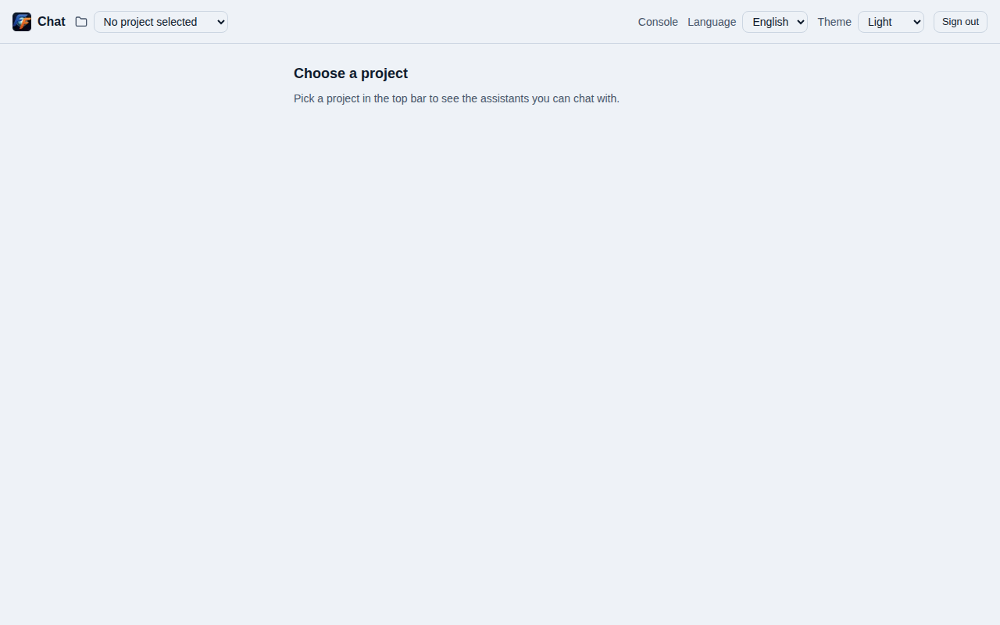 | 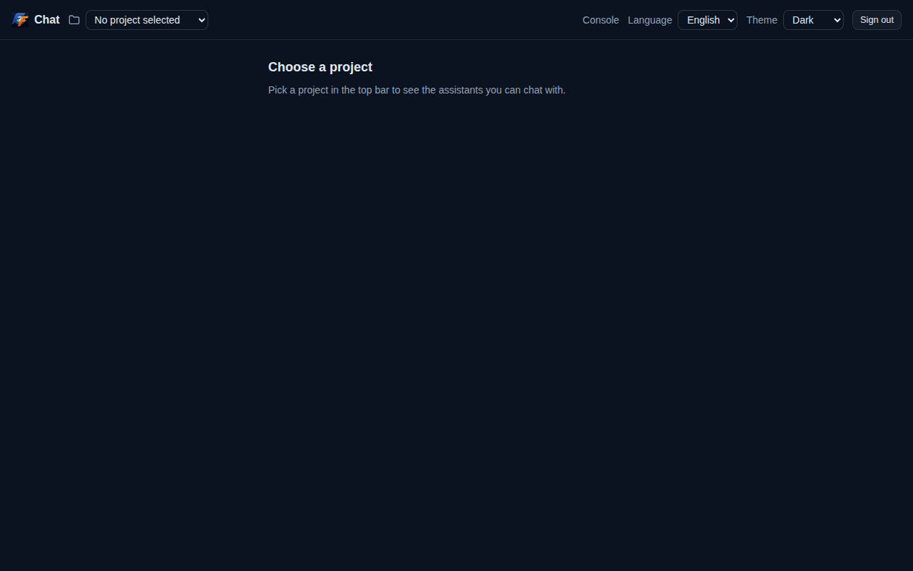 |
| Assistants | 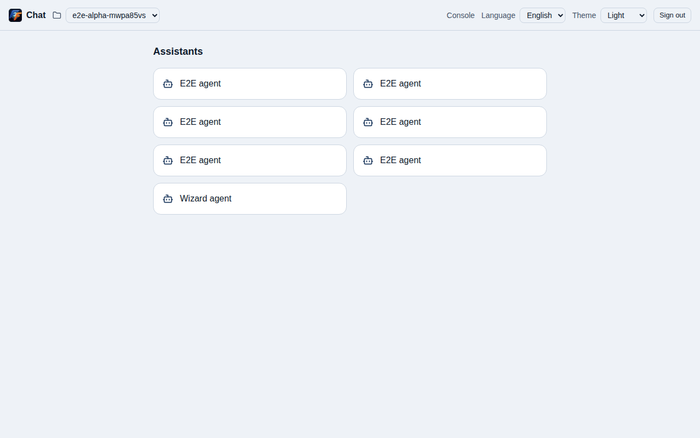 | 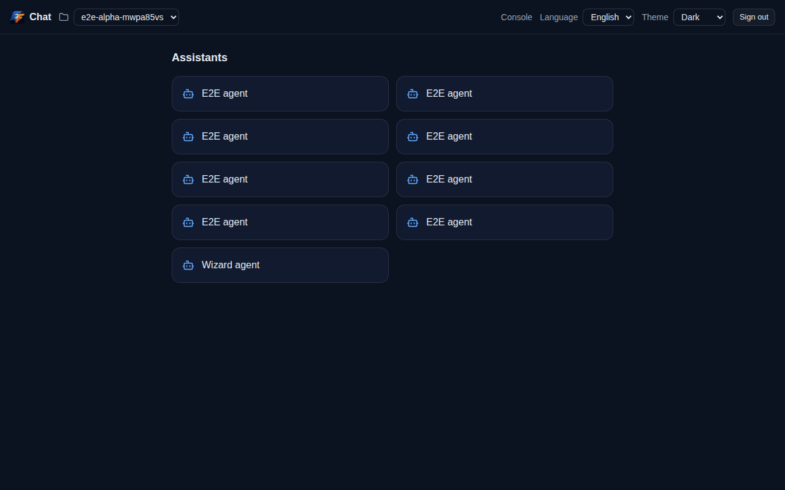 |
| Chat | 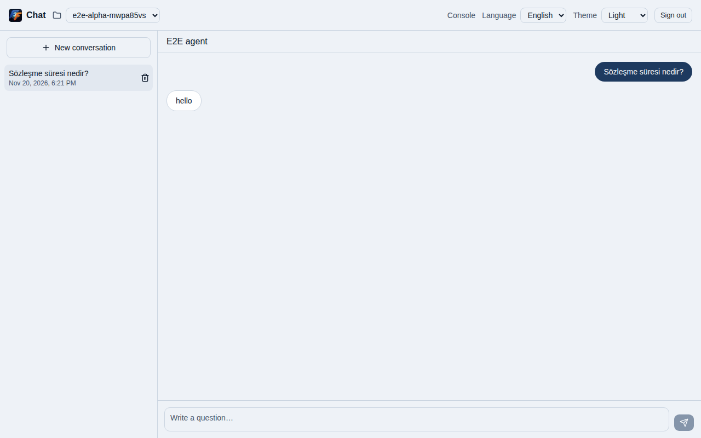 | 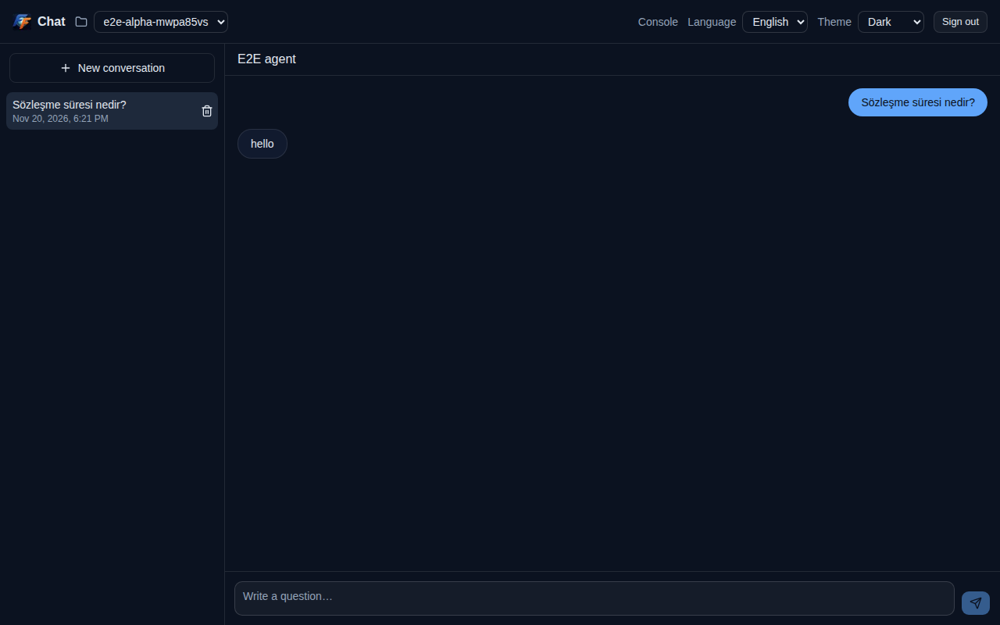 |
| Chat on a phone | 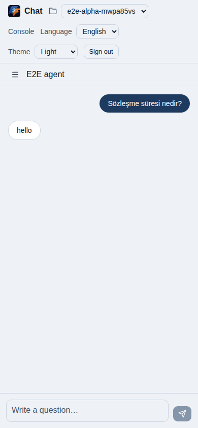 | 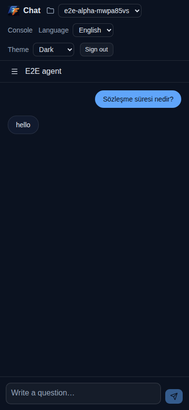 |
| Chat with portal settings | 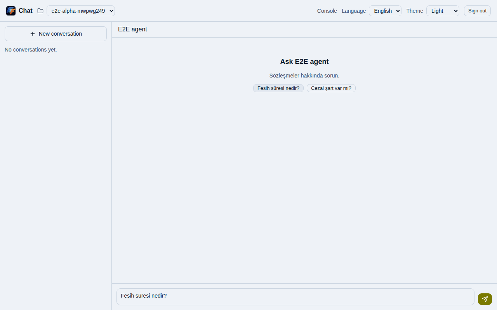 | 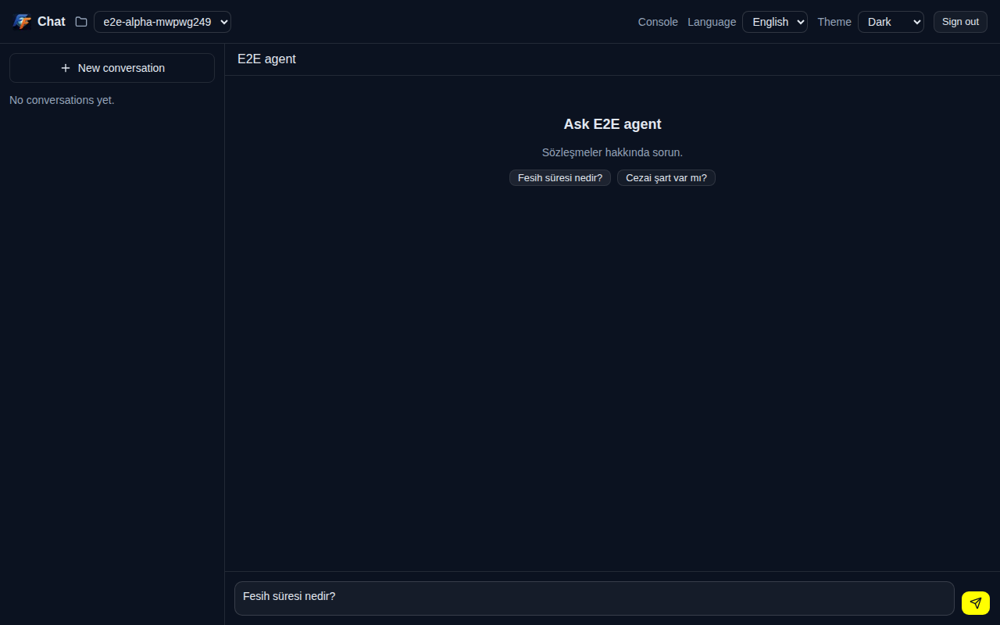 |
| Console Portal tab | 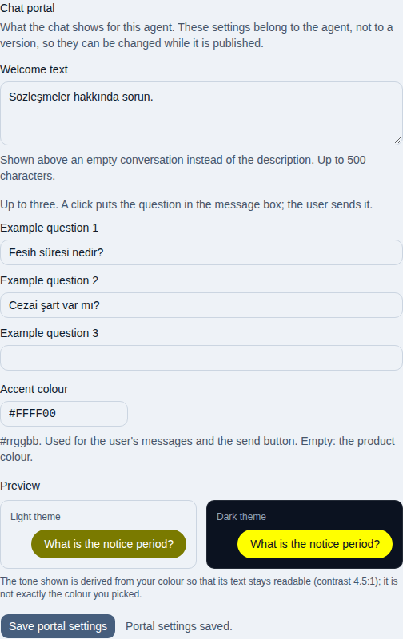 | 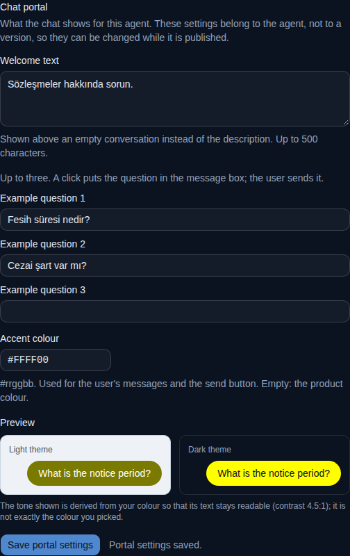 |
