# User memory (package 14)

The assistant remembers lasting facts about each member of a project: their role, preferences,
recurring context and explicit decisions. "I want tables in TL" said once applies to every later
answer, in every conversation, until the member deletes it. Memory stays inside the organisation:
the items are in the platform's Postgres, the member sees and controls them, administrators see
numbers only.

Memory is **off** by default. An administrator turns it on for a project (or one agent) once the
installation has its NER model (see "Requirement" below).

## Requirement: the NER model

Memory never stores personal data. Every item, whether the extraction model proposed it or the
member typed "remember this", goes through the memory PII check: the project's PII categories
(its stored `default` policy, custom patterns included) plus **person names through NER**. A
match drops the item and records a `guardrail_events` row (policy `memory`, stage `input.pre`,
categories only, no text preview).

Person names can only be found with the NER model, so memory can be turned on only where
`NER_MODEL` and `NER_REVISION` are set and the weights are in the offline model cache
(`make models`; `docs/guardrail.md`). Without them:

- `PUT …/memories/settings` with `enabled: true` answers 422 `memory_requires_ner`, and the
  console shows the switch disabled with the reason;
- if NER is removed later while memory is on, every write ("remember this", edit, the extraction
  job's candidates) answers 422 `memory_requires_ner`; nothing is written with a weaker check.

## How it works

1. **Learning.** After a completed run of a member, a background job (`llm-background` queue,
   model slot interactive-low: it never delays an answer) gives the finished turn and the member's
   5 closest items to the extraction model (`memory_extract` prompt, the settings' extraction
   model). The answer is JSON with 0-3 candidates (`kind`, `text`, `confidence`,
   `supersedes_id`). Each candidate passes, in order: the block markers check, the allowed
   kinds, the confidence threshold (`MEMORY_MIN_CONFIDENCE`: llmaas 0.6, airgap 0.7), the PII
   check, then dedupe (similarity > 0.9, or the model's `supersedes_id`, archives the old item).
   Over `max_items_per_user` the least used older item is archived; the new one stays active.
   In llmaas the turn goes through the 08 `egress` stage before it leaves for the provider.
2. **Remember this.** The member's own text (`POST …/memories`) skips the extraction model
   (`kind=preference`, `confidence=1`) but never the PII check.
3. **Recall.** In `prepare`, every active `profile` item and the `recall_top_k` other items
   closest to the question (allowed kinds only) are added to the system message as a marked
   block: they are context, the member's current words win. The block fits
   `context_policy.memory_max_tokens`; items that do not fit are named in `budget.dropped.memory`
   and are not counted as used. The run records `memory_used` (ids and kinds only).

Kinds: `profile` and `preference` are valid in every agent of the project; `fact` and
`decision` only in the agent of the run that taught them.

## What the member sees (chat)

- **My memory** (`/memory`, linked from the chat header and the console user menu): the active
  items with kind, when they were learned and how often they were used; edit, delete (at once
  and for good), delete all (confirmed), "remember this", and a switch that turns memory off for
  the member (opt-out: nothing is remembered or used; existing items stay until deleted).
  Archived items (superseded or over the limit) are listed apart; they are not used.
- **Under an answer:** "I took N remembered items into account", opened to show the items with a
  one-click **Forget this**. The list is read from the run's events after the run has ended
  (`memory_used` does not travel on the stream) and the texts from the member's own
  `GET …/memories?ids=`.
- **After a turn answered on screen:** "I noted: … [Delete]" once the extraction job has written
  something. The chat reads the run's events every 5 seconds for 2 minutes; the job may wait for
  its model slot, so after that the line says notes may appear later in My memory. Nothing is
  shown when memory is off, opted out or nothing was written.
- **Failures are shown:** if the items cannot be read, a line with the code replaces the card; a
  failed forget or delete leaves the item in place with an error and its code. N is the number of
  items still there: a forgotten item drops out, and the card goes away when none is left.

Read-only access does not limit any of this: memory is the member's own data.

## What the administrator sees (console)

- **Settings → Memory** (`/settings`, admin): the project default (on/off, allowed kinds, items
  per member, items recalled per question, keep for N days, extraction model: an active chat model
  of the project), the principle "administrators cannot see what is remembered", and the
  statistics: active and archived items, by kind, share used at least once, deletes by members
  (audit events), members with memory off, and the same per member. No text anywhere.
- **Agent wizard → Memory** tab: the agent's own settings row (it wins over the project's); the
  badge says whether the project default or the agent's own values are in use. Agent level, not
  versioned: saved on its own, like the Portal tab. Analysts see that the settings are an
  administrator's.
- Read access: the values and numbers, the controls disabled.
- An administrator (superadmin included) gets 403 `memory_not_owner` on someone else's item;
  the audit trail records memory events without their content.

## Infrastructure access (limit)

The rules above hold for platform roles. Whoever has infrastructure access sees more: the
database and its backups hold the item texts, and the Langfuse trace of a run carries the full
prompt LiteLLM sent, memory block included (the run events carry `[memory: n items <ids>]`
instead). Treat Langfuse and database access as access to member data (package 12 hardening).

## Settings and configuration

| Where | What |
|---|---|
| `…/memories/settings` (`agent_id` optional) | `enabled`, `allowed_kinds`, `max_items_per_user` (200), `recall_top_k` (5), `ttl_days` (none), `extraction_model` (`memory-extract`). The extraction model is checked against the project's active chat models when memory is turned on or the model is changed; turning memory off always works. |
| `MEMORY_MIN_CONFIDENCE` | extraction threshold (llmaas 0.6, airgap 0.7; `.env.example`) |
| `context_policy.memory_max_tokens` | the memory share of a run's budget (agent definition, C8) |
| Retention class `memory` | items unused for `keep_days` (365) and expired ones are deleted |

## Error codes

| Code | Status | When |
|---|---|---|
| `memory_pii_blocked` | 400 | the text holds personal data (reference in the message) |
| `memory_text_invalid` | 400 | the text holds the memory block's markers `[USER MEMORY]` / `[/USER MEMORY]` |
| `model_not_found` | 400 | the settings name an extraction model the project does not have |
| `memory_not_owner` | 403 | someone else's item |
| `memory_disabled` | 409 | memory is off for the project |
| `memory_opted_out` | 409 | the member turned memory off |
| `memory_kind_not_allowed` | 409 | "remember this" while `preference` is not an allowed kind |
| `memory_requires_ner` | 422 | turning memory on, or any write, without the NER model |
| `memory_user_missing` | 422 | the caller is not a signed-in user (an API key) |
| `memory_unavailable` | 502 | a memory call of the agent worker failed (`detail`: the API or transport code) |

Run events: `budget.memory` is `on`, `off`, `opt_out` or `no_user`; `budget.question_truncated`
is `true` when a question longer than a run's input limit (a facade question) was searched with
its first 20,000 characters (the model still gets all of it). The extraction outcome is a
`progress` event `{"memory_extraction": {...}}` with ids and counts, or `skipped` / `error`.

## Screenshots

| Screen | Light | Dark |
|---|---|---|
| My memory | 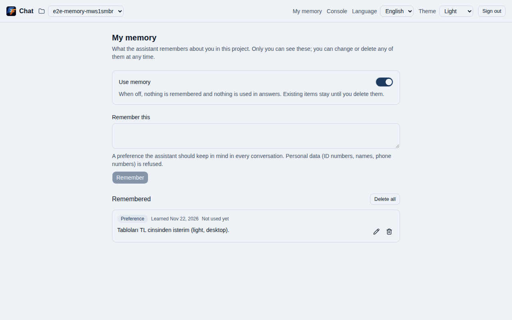 | 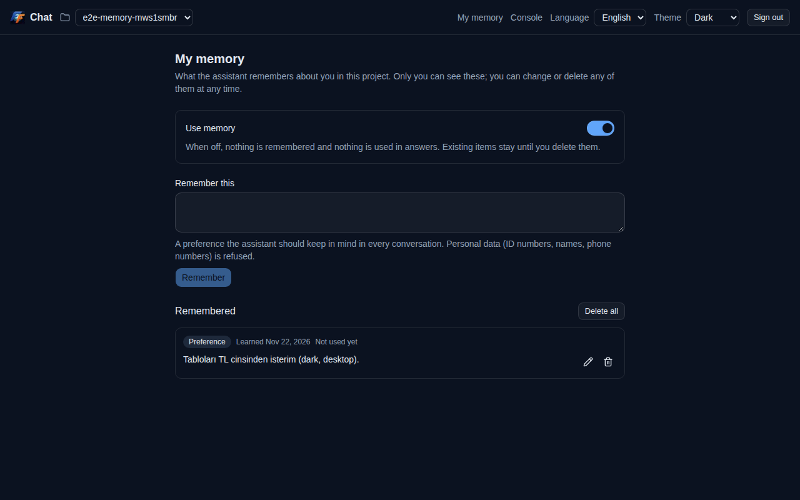 |
| My memory on a phone | 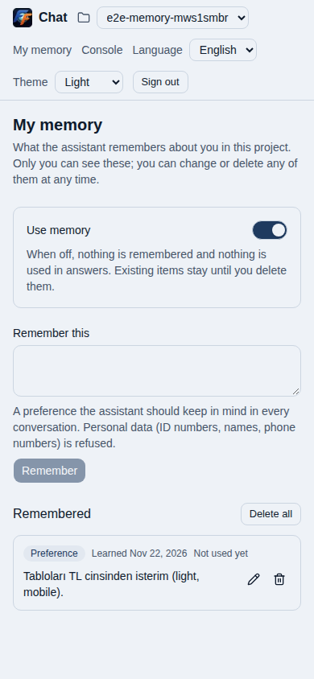 | 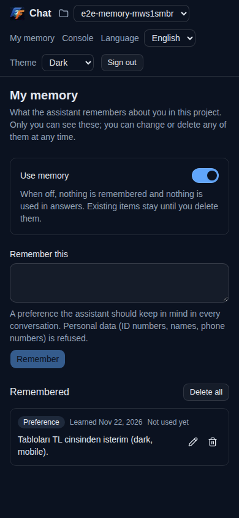 |
| Answer with the memory note | 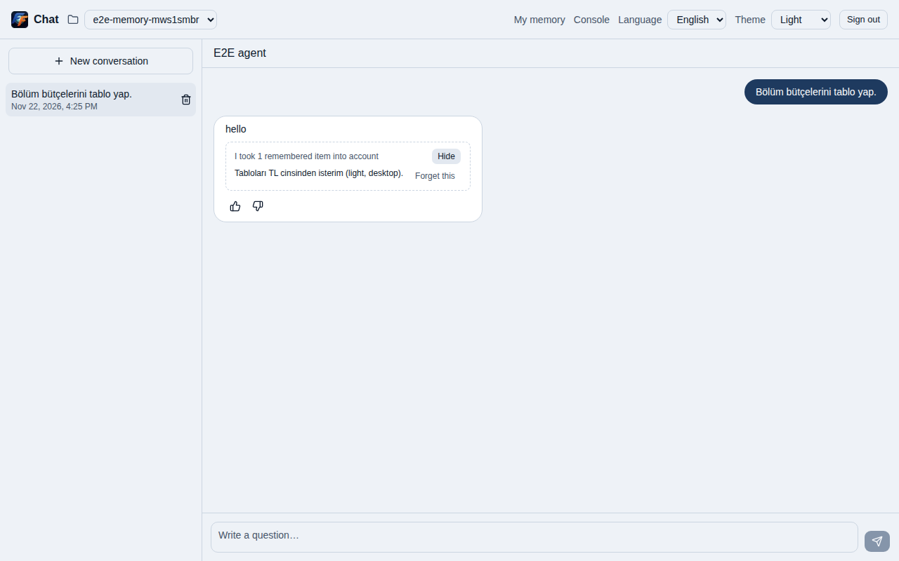 | 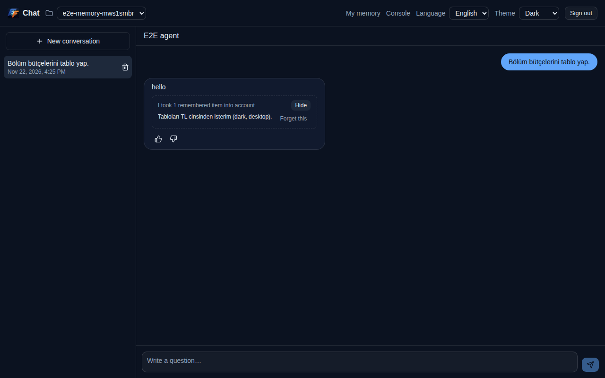 |
| Answer on a phone | 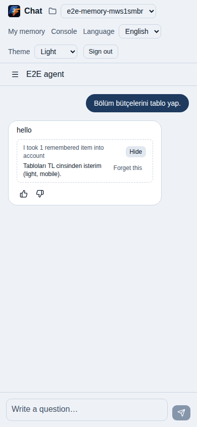 | 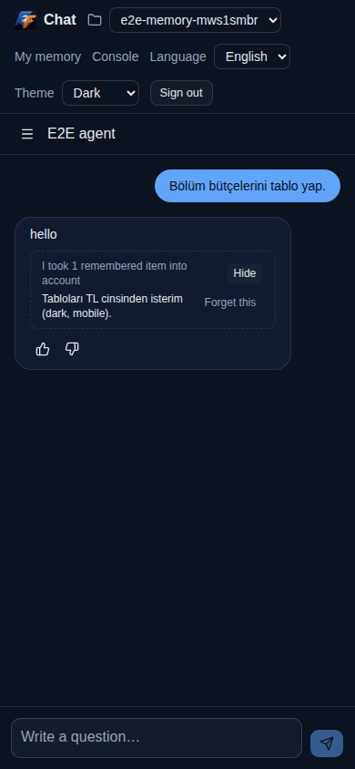 |
| Settings → Memory | 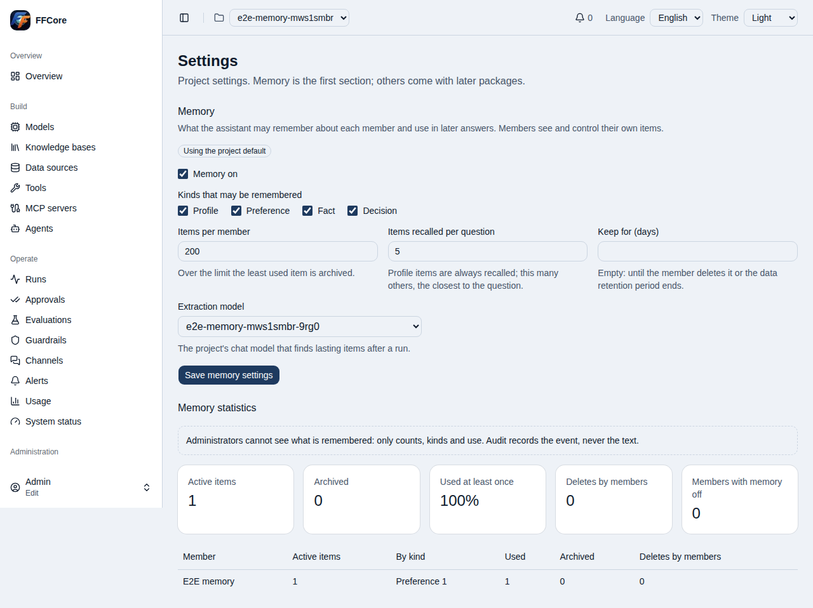 | 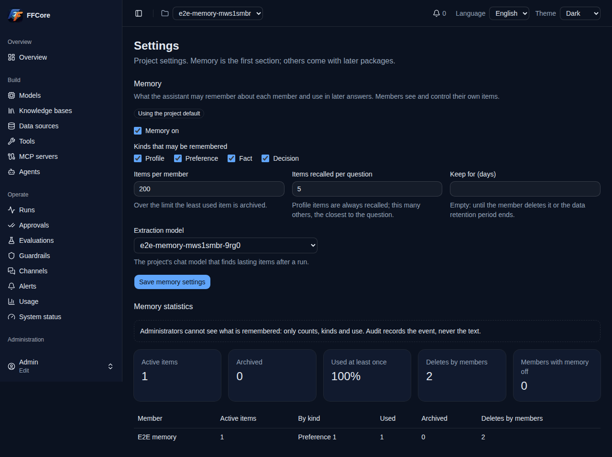 |
| Agent wizard Memory tab | 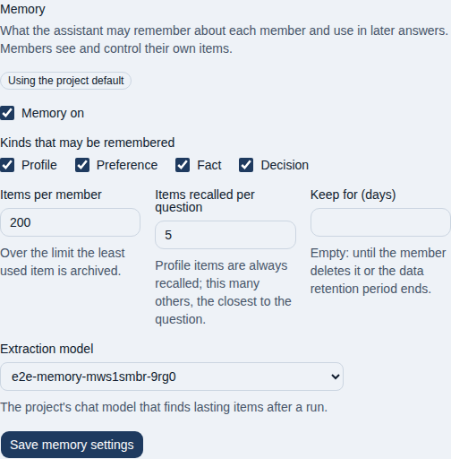 | 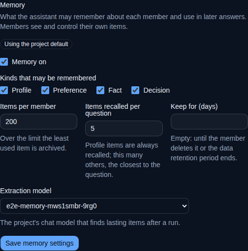 |
