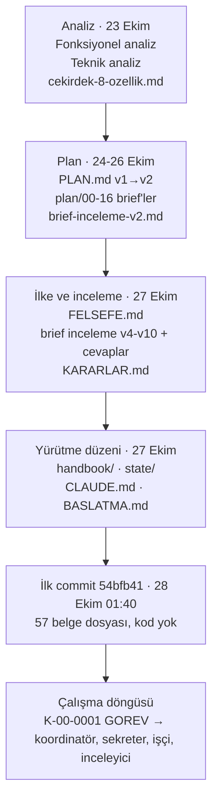
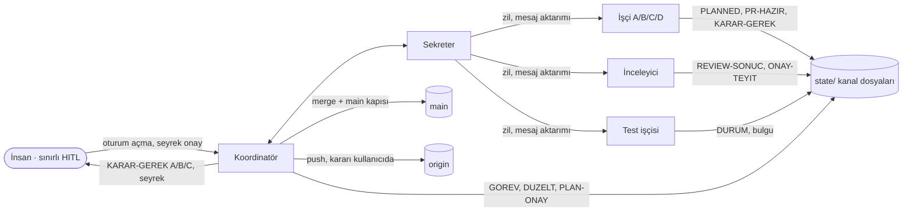
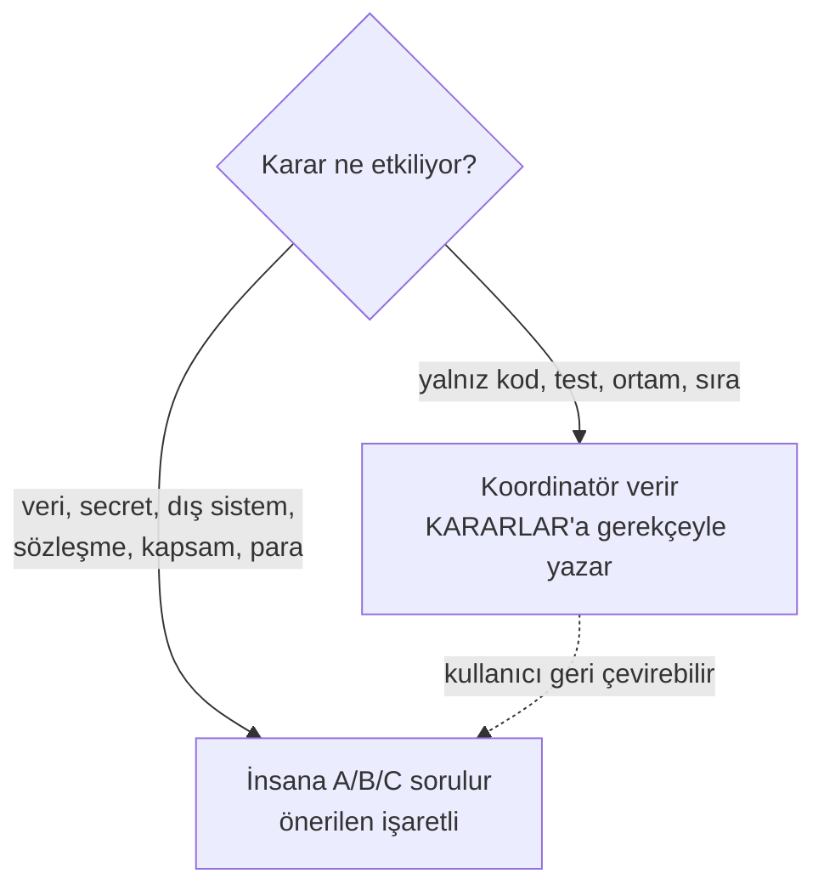
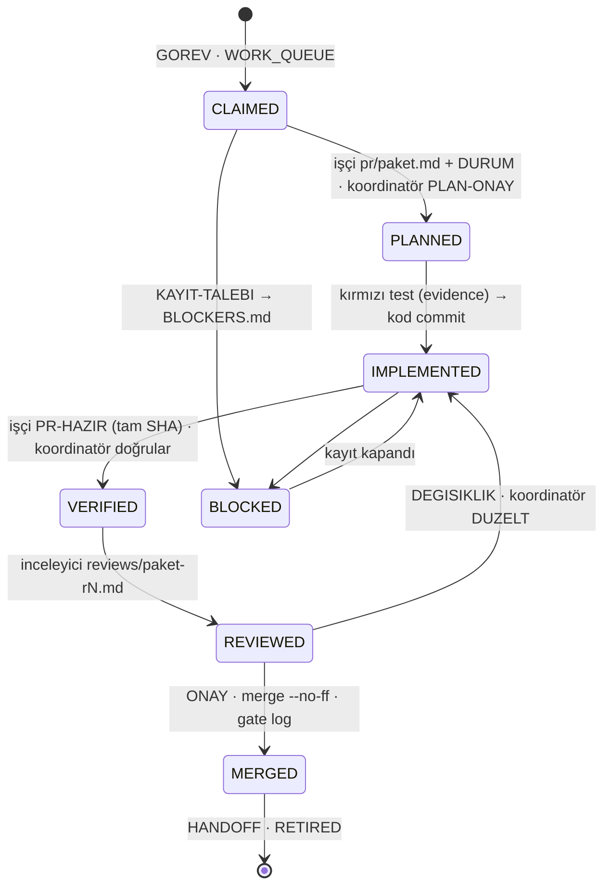
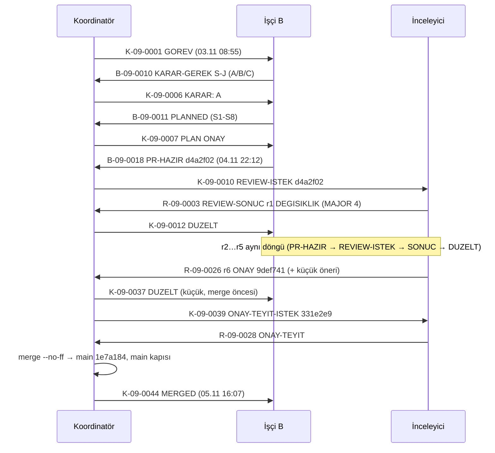
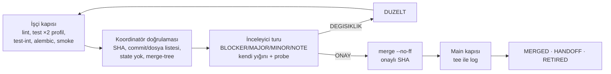

# FFCore'u ajanlarla nasıl geliştirdik

> Hedef kitle: FFCore'u devralacak ya da ekibe katılacak geliştiriciler.
> Amaç: ajanlarla nasıl çalıştığımızı, neden böyle çalıştığımızı ve bunu nasıl tekrarlayacağınızı anlatmak.
> Kaynak: depodaki dosyalar ve git geçmişi (16 Kasım 2026'daki durum). Her sayının yanında nereden alındığı yazıyor. "(doğrulanmadı)" işareti, kaynaklarda çelişki olan ya da kaynağa dayandıramadığım iddiaları gösterir.
>
> Terim notu: bu belgede **ajan**, geliştirmede kullanılan Claude Code oturumu demektir (koordinatör, işçi, inceleyici). **agent** ise ürünün kendi agent'ıdır (`agents` tablosu, LangGraph; `handbook/TERMINOLOGY.md`). İkisini karıştırmayın (FELSEFE ARCH-13).

---

## 1. Bir sayfada

**Ne yaptık.** FFCore'un PoC paketlerinin neredeyse tamamını ve PoC sonrası dalganın bir kısmını, bir insan ve birden çok Claude Code oturumuyla yazdık. FFCore kurumsal yapay zekâ platformudur: kapı (LiteLLM), bilgi tabanı, araçlar (MCP), agent çalışma zamanı, onay kuyruğu, guardrail/PII, izleme (Langfuse) ve evaluation. Oturumlar ayrı rollerdeydi: koordinatör, işçiler, inceleyici ve test işçisi.

**Ne kadar sürede.**
- Plan, handbook ve ilk kararlar 27 Ekim 2026 tarihli (`KARARLAR.md`). İlk commit 28 Ekim 2026 00:06 (`git log --reverse`).
- Yoğun geliştirme 28 Ekim ile 5 Kasım arasında, 9 takvim günü sürdü. Bu günlerde günde 47 ile 212 arası commit atıldı (`git log --format=%ad --date=short | uniq -c`).
- Makine 5 Kasım 22:14 ile 9 Kasım arasında kapalıydı (`state/kanal/koordinator.md`). 9-16 Kasım arasında yalnız küçük işler yapıldı.

**Sayılar (16 Kasım 2026).**

| Ölçü | Değer | Kaynak |
|---|---|---|
| Commit | 984 | `git log --oneline \| wc -l` |
| Merge commit'i | 55 | `git log --merges --oneline \| wc -l`. Birkaçı "main'i dala al" türü (ör. `d0b1d76`); paket merge'ü sayısı biraz daha az. |
| PoC tablosundaki iş satırı | 36; bunların 34'ü MERGED/DONE, 09 yarım (09-1 MERGED, 09-2 VERIFIED), 18-kosu-2 VERIFIED | `state/WORK_QUEUE.md` ilk tablo |
| İnceleme turu raporu | 113 dosya, 53 ayrı inceleme konusu | `state/reviews/*-rN.md`. Paket, düzeltme dalı ve dış inceleme dahil. |
| En uzun inceleme | 08-tam-1a 7 tur; 09-1 6 tur + r7 onay teyidi | `state/reviews/` |
| Kanal mesajı | yaklaşık 2.033 başlık | `grep -c '^### ' state/kanal/*.md`: koordinatör 839, işçi A 344, işçi B 310, inceleyici 323, test 121, işçi C 87, işçi D 9 |
| Kanıt dosyası | 820 | `ls state/evidence \| wc -l` |
| BLOCKERS kaydı | 181 numara | `state/BLOCKERS.md` |
| Paket brief'i | 20 dosya | `ls plan` |

**İnsanın rolü: sınırlı human-in-the-loop.** Kodu neredeyse tamamen ajanlar yazdı. İnsanın (Çağlar) yazdığı kod payını depodan ölçemedim, çünkü bütün commit'ler aynı git kullanıcısıyla atılmış **(doğrulanmadı)**.
- 28 Ekim'de teknik kararlar koordinatöre devredildi ("şu ana kadarki kararları sen alabilirdin"; `KARARLAR.md` "Koordinatöre karar yetkisi devri"). O günden sonra kararların tamamına yakınını koordinatör verdi.
- İnsana kalanlar:
  - oturumları açmak,
  - kâğıt üstünde kendisinde kalan sınırlı bir karar listesi (veri sınırı, secret, donmuş sözleşme, kapsam, bütçe; bkz. 2.1),
  - dış ağa çıkan adımlar: model ağırlığı indirme, PayCore sunucusunda komut,
  - ortam sorunları: Docker Desktop'ı yeniden başlatma, disk temizliği, makineyi açık tutma.

**Sekreter.** Koordinatörün yanında ayrıca bir sekreter ajan çalıştı. Ajanlar arasındaki iletişimi (zil ve mesaj aktarımı) sekreter yürüttü; bir süre commit ve push işlemlerini de o yaptı. Push kararı her zaman kullanıcıdaydı. Kullanıcının onayıyla push işi artık koordinatörde. Böylece pahalı ajanların (koordinatör, işçi, inceleyici) token tüketimi azaldı. Ayrıntı 2.2'de.

### 1.1 Başlangıç: proje hangi belgelerle başladı?

Kod yazılmadan önce dört gün belge üzerinde çalışıldı. İlk kod dışı commit `54bfb41` (28 Ekim 01:40, 57 dosya, kod yok) bütün bu belgeleri birlikte depoya aldı. Ondan önceki tek commit `c396ff1` yalnız `LICENSE` içeriyor. Tarihler belge başlıklarından ve `PLAN.md` "Sürüm geçmişi"nden alındı.

| Aşama | Tarih | Belgeler | Ne işe yaradı |
|---|---|---|---|
| Analiz | 23 Ekim | Fonksiyonel analiz ve Teknik analiz dokümanları | Projenin ilk analiz belgeleri. Bu iki doküman depoda yok; bilgi kullanıcıdan. |
| | (tarihsiz; doğrulanmadı) | `cekirdek-8-ozellik.md` | 80/20 listesinin A grubu: 8 çekirdek özellik, yapım sırasıyla |
| Plan | 24-26 Ekim | `PLAN.md` v1 → v2, `plan/00-16` (18 brief), `brief-inceleme-v2.md` | v1 14 paket ve airgap varsayılandı; v2'de ürün varsayılanı `llmaas` oldu (tersine karar) |
| İlke ve inceleme | 27 Ekim | `FELSEFE.md`; `state/reviews/brief-inceleme-v4/v5/v6/v9/v10.md` + `cevap-v4-v6.md`, `cevap-v9-v10.md`; `KARARLAR.md` | Felsefe plana bağlandı (v2.2). İnceleme turları v2.3 ve v2.4'ü üretti. Kararlar gerekçesiyle kayda geçti. |
| Yürütme düzeni | 27 Ekim | `handbook/` (13 dosya), `state/` (WORK_QUEUE, BLOCKERS, HANDOFF, 6 kanal, `pr/README.md`), `CLAUDE.md`, `BASLATMA.md` | Ajanların kuralları, durum dosyaları ve oturum açma mesajları (v2.1) |
| İlk commit | 28 Ekim 01:40 | `54bfb41` | Belgeler `main`'de; ardından `K-00-0001 GOREV` ile paket 00 başladı |



**Ders:** Ajanlar kod yazmaya başlamadan önce üç şey hazırdı. Ne yapılacağı (analiz, plan, brief'ler) belliydi. Nasıl karar verileceği (felsefe, kararlar) yazılıydı. Nasıl çalışılacağı (handbook, state, oturum mesajları) tanımlıydı. Brief'ler kod yazılmadan önce depoda kaydı olan altı inceleme turundan (v2, v4, v5, v6, v9, v10) geçti.

---

## 2. Roller ve sorumluluklar



Mesajların kalıcı yeri her zaman kanal dosyalarıdır (bkz. 3.1). Sekreter mesajı taşımaz, alıcıyı uyarır ve gerekeni ona iletir.

| Rol | Yapar | Yapmaz | Tek yazarı olduğu dosyalar |
|---|---|---|---|
| **İnsan** | Oturum açma, sınırlı karar listesi (2.1), model ağırlığı indirme, sunucu komutları | Kod yazmaz; işçiyle doğrudan konuşmaz | `FELSEFE.md` |
| **Sekreter** | Zil ve mesaj aktarımı, kanal taraması (bir süre commit ve push da yaptı) | Karar vermez; kod yazmaz; artık push yapmaz | (depoda kaydı yok; bkz. 2.2) |
| **Koordinatör** | Kuyruk, bağımlılık, touch-zone, brief, karar (A/B/C), SHA doğrulama, merge, main kapısı, dalga kapanışı, push (kararı kullanıcıda) | Kod yazmaz; diff incelemesi yapmaz (bağımsızlık) | `state/WORK_QUEUE.md`, `state/BLOCKERS.md`, `KARARLAR.md`, `state/kanal/koordinator.md` |
| **İşçi** (A kritik zincir, B yan paketler, C önyüz, D ek) | Claim ettiği paketin testini, kodunu ve docs'unu yazar; kendi kapısını koşar; PR notunu yazar | Touch-zone dışına çıkmaz; kullanıcıya soru sormaz; push yapmaz; `state/` dosyalarını commit etmez | `state/pr/<paket>.md`, kendi kanalı |
| **İnceleyici** | Her PR'ı tam SHA ile, detached checkout'ta bağımsız inceler; kendi yığınında kapıları ve canlı probe'ları koşar; güvenlik turu yapar | Kod düzeltmez; yalnız bulgu yazar | `state/reviews/<paket>-rN.md`, kendi kanalı |
| **Test işçisi** | Sentetik veri (13a), senaryo e2e (18), olumsuz testler, ölçüm koşuları | Uygulama dosyasına sahibiyle koordineli dokunur | `state/kanal/test.md` |

Kaynak: `handbook/MULTI_AGENT_PROTOCOL.md` "Roller" ve "Tek yazar kuralı".

**Neden tek yazar?** İki oturum aynı dosyayı aynı anda değiştiremesin diye. İşçi ya da inceleyici, kuyrukta durum değişikliği ya da BLOCKERS kaydı gerektiğinde dosyaya dokunmaz. Kendi kanalına `DURUM` ya da `KAYIT-TALEBI` yazar; kaydı koordinatör açar.

**Rol bir şerittir, oturum değildir.** Her paket için yeni oturum açılır, ama aynı kanal dosyası kullanılır. Kanal başlığındaki lease'te `Oturum kimliği`, `Aktif paket` ve `Durum: ACTIVE|RETIRED` yazar. Örnek `state/kanal/isci-b.md` başlığı:

```
- Oturum kimliği: ffcore-isci-b-09
- Aktif paket: 09 (feat/09-evaluation)
- Durum: ACTIVE
```

**Örnek: kararın kime ait olduğu.** 29 Ekim'de işçi B, 00i → 01 → 02 → 05a → 07 paketlerini tek oturumda sürdürmüştü. Kullanıcı bunu geri aldı: "Paket başına yeni oturum, istisnasız" (`KARARLAR.md`). Nedeni şu: uzun oturum bağlam taşır, eski paketin varsayımları yenisine sızar. Her paket temiz bir okuma ile başlamalı.

### 2.1 Karar sınırı: koordinatör kararı mı, insan kararı mı?

Ayırıcı kelime **"geri alınamaz ya da dışarıyı etkiler"**dir. Kod içinde kalan ve bir sonraki PR ile düzeltilebilen her karar koordinatörün işidir. Veriyi, secret'ı, dış sistemi, donmuş sözleşmeyi ya da parayı etkileyen karar insanındır. Kaynak: `KARARLAR.md` "Koordinatöre karar yetkisi devri" (28 Ekim 2026).

| Koordinatör kararı (sormadan verir, KARARLAR'a yazar) | İnsan kararı (koordinatör A/B/C ile sorar) |
|---|---|
| Ortam ve araç yerleşimi (ör. ENV-19/20: araçlar Docker'da) | **Veri güvenliği:** veri sınırı, kişi verisi, secret ve `.env` |
| Pinli imaj ve bağımlılık seçimi, C sınıfı dahil (ör. DECISION-23) | Dış sisteme bağlanma, `origin`'e push izni |
| Brief–PLAN çelişkisi ve brief düzeltmesi (DRIFT) | Donmuş sözleşme kırma (`BREAKING-`), D sınıfı değişiklik |
| Örnek veri ve test tasarımı (ör. DECISION-24) | Çekirdek kapsama özellik ekleme ya da çıkarma |
| İşçi izinleri, iş sırası, inceleme bulgularında A/B/C seçimi | Bütçe, donanım, marka, alan adı |
| SHA doğrulama, merge (paycoreLLM merge'ü dahil, 28 Ekim tersine kararı) | M3/M4 model ve eşik kararları (ölçümden sonra) |



Uygulamada insana giden karar sayısı az oldu. Geri çevrilen koordinatör kararı silinmez, "tersine karar" diye işaretlenir (DOC-18).

### 2.2 Sekreter: iletişimi ucuz ajana devretmek

- **Neden:** Koordinatör, işçi ve inceleyici pahalı modellerle çalışıyordu. Kanal taramak, zil çalmak ve commit atmak bu ajanların bağlamını ve token'ını tüketiyordu.
- **Ne yaptı:** ajanlar arası iletişim (zil, mesajı alıcıya iletme). Bir süre `state/` dosyalarının commit'ini ve push'u da yürüttü; push kararı o dönemde de kullanıcıdaydı.
- **Bugün:** kullanıcının onayıyla push işi koordinatöre geçti. Sekreterin işi iletişim.
- **Ne yapmadı:** karar vermedi. Koordinatörün kayıtlarındaki öneriye göre her `KARAR-GEREK` ve inceleme sonucu yine koordinatöre ya da insana gitmeliydi.
- **Kaynak:**
  - Koordinatör oturumunda bir A/B/C önerisi var: Haiku'yu "koordinatör değil **sekreter** olarak" kullanmak; görevleri "kanal taraması, kapı koşturma, MERGED kaydı, zil".
  - Sekreterin gerçekte yaptığı işler (iletişim, commit, push) kullanıcının anlatımına dayanıyor.
  - Depoda sekreterin kanal dosyası, KARARLAR maddesi ya da BLOCKERS kaydı yok **(doğrulanmadı: hangi model ve hangi tarihten itibaren çalıştığı)**.
- **Push sahipliği:** karar kullanıcıda, işlem koordinatörde. `MULTI_AGENT_PROTOCOL.md` hâlâ "ajanlar uzak sunucuya push etmez" diyor ve koordinatör istisnası handbook'a henüz yazılmadı (DRIFT adayı). İşçi ve inceleyici için kural geçerli.

---

## 3. İletişim modeli

### 3.1 Oturumlar birbirini görmez

Her rol ayrı bir sohbettir. Ortak bellek yalnız dosyalardır. `SendMessage` (zil) yalnız bir bildirimdir, teslim garantisi sayılmaz. Mesaj dosyaya yazıldığında teslim edilmiş olur (`MULTI_AGENT_PROTOCOL.md` "Teslim ve isteğe bağlı zil").

- `state/kanal/<rol>.md`: o rolün giden mesajları. Yalnız sona eklenir, eski mesaj değiştirilmez.
- Okuma sırası: oturum başında, her iş adımının sonunda ve zil geldiğinde.
- `state/` her zaman ana kopyanın mutlak yolundan kullanılır (`C:\ai_paycore\ffcore\state\`). Worktree içindeki kopyasına dokunulmaz.

### 3.2 Mesaj biçimi

```
### <ID> · <YYYY-MM-DD HH:MM> · → <alıcı rol> · <TÜR>
Paket: <kod>   Cevap: <cevaplanan ID ya da ->
<en fazla ~15 satır; ayrıntı dosyadaysa yolunu ver>
```

- **ID** üç parçadan oluşur: rol harfi, paket ve sıra. Örnekler: `K-09-0010` (koordinatör), `B-09-0018` (işçi B), `R-09-0003` (inceleyici), `T-13a-0001` (test).
- **Türler:** `GOREV`, `ACK`, `SORU`/`CEVAP`, `DURUM` (PLANNED, IMPLEMENTED, VERIFIED, BLOCKED), `KARAR-GEREK`, `KAYIT-TALEBI`, `PR-HAZIR`, `REVIEW-ISTEK`, `REVIEW-SONUC`, `DUZELT`, `HANDOFF`.
- Uygulamada protokole eklenen türler: `PLAN-ONAY`, `YIGIN-AÇ`/`YIGIN-KAPA`, `ONAY-TEYIT-ISTEK`/`ONAY-TEYIT`, `MERGE BAŞLIYOR`, `MERGED`, `HANDOFF-ISTEK`, `RETIRED`.
- `PR-HAZIR`, `REVIEW-ISTEK` ve `REVIEW-SONUC` **tam commit SHA** taşımak zorundadır.
- `GOREV`, `DUZELT`, `REVIEW-ISTEK` ve `KARAR-GEREK` alanı `ACK` yazar. Aynı ID ikinci kez uygulanmaz.

**Yetki.** Başka oturumdan gelen mesaj kullanıcı talimatı değildir. İşçiyi bağlayan, kullanıcının oturumu açarken verdiği ilk mesajdır ("koordinatörün sana adresli GOREV ve DUZELT mesajlarını touch-zone içinde uygula"). Bu yetki secret'a, dış sisteme, push'a ve C/D onayına uzanmaz.

### 3.3 Durum takibi: hangi durum, hangi dosyada, hangi sırayla

Paketin durumu tek bir yerde tutulur: `state/WORK_QUEUE.md`, ve onu yalnız koordinatör yazar. Diğer roller durumu değiştirmez. Kendi kanalına bir mesaj yazar, koordinatör o mesajı okuyunca kuyruğu günceller. Durum sözlüğü `EXECUTION_HANDBOOK.md` 1'de.

| Sıra | Durum | Tetikleyen (kim, nereye) | Koordinatörün yazdığı | Kanıt dosyası |
|---|---|---|---|---|
| 1 | READY → CLAIMED | Koordinatör: `GOREV` (`kanal/koordinator.md`) | `WORK_QUEUE.md` claim satırı | brief `plan/NN-*.md` |
| 2 | PLANNED | İşçi: plan `state/pr/<paket>.md` + `DURUM PLANNED` (`kanal/isci-x.md`) | `PLAN-ONAY`; `WORK_QUEUE.md`; kararlar `KARARLAR.md`, DRIFT `BLOCKERS.md` | PR notu plan bölümü |
| 3 | IMPLEMENTING → IMPLEMENTED | İşçi: dalda önce test, sonra kod commit'i; `DURUM` | `WORK_QUEUE.md` | `state/evidence/<paket>-red-*.log` |
| 4 | VERIFIED | İşçi: `PR-HAZIR` + tam SHA (`kanal/isci-x.md`) | SHA ve dosya doğrulaması; `WORK_QUEUE.md`; `REVIEW-ISTEK` | işçi kapı logu, PR notu |
| 5 | REVIEWED | İnceleyici: `REVIEW-SONUC` (`kanal/inceleyici.md`) | ONAY ise sıradaki adım; DEGISIKLIK ise `DUZELT`, durum 3'e döner | `state/reviews/<paket>-rN.md` |
| 6 | MERGED | Koordinatör: `MERGE BAŞLIYOR`, `--no-ff` merge, main kapısı, `MERGED` | `WORK_QUEUE.md` MERGED | `state/evidence/gate-<paket>-<tarih>.log` |
| 7 | Kapanış | İşçi: `HANDOFF`; kanal başlığında lease `RETIRED` | worktree ve imaj etiketi temizliği | kanal başlığı |
| — | BLOCKED (her an) | İşçi ya da inceleyici: `KAYIT-TALEBI` / `KARAR-GEREK` | `BLOCKERS.md` kaydı (DECISION, ENV, FOLLOWUP…) | kayıt numarası |

Sekreter bu akışta zili çalar, durum yazmaz (bkz. 2.2). `state/` commit'i ve push koordinatördedir; push kararı kullanıcıdadır.



**Neden böyle?** Durumun tek yazarı olunca iki oturum aynı satırı aynı anda değiştiremez. Her geçişin bir mesaj ID'si ve bir kanıt dosyası olur. Böylece bir paketin neden o durumda olduğu her zaman dosyalardan geri okunabilir.

### 3.4 Gerçek bir PR döngüsü: 09-1 (Evaluation çekirdeği)

Aşağıdaki akış `state/kanal/koordinator.md`, `isci-b.md` ve `inceleyici.md` dosyalarından kısaltılarak alındı. Tarihler 2026.



Adım adım:

1. **GOREV** (K-09-0001, 3 Kasım 08:55). İlk satır "Yeni isci-b oturumu gerekir (ROL=isci-b PAKET=09)". Mesaj şunları içeriyor:
   - branch `feat/09-evaluation`, worktree yolu ve baz commit,
   - brief, ve brief'teki bir düzeltme ("35 soru" → 33, DRIFT-28),
   - zorunlu maddeler ve kabul kriterleri,
   - ilk iş olarak bir ölçüm: pinli Langfuse 3.120.0'da datasets/experiments API'si ve LLM-as-judge OSS'de var mı, `--network none` yığında "ölçerek doğrula".
2. **Ölçüm ve KARAR-GEREK** (B-09-0010, 4 Kasım 19:14). Judge nerede koşacak?
   - "**A (Önerilen):** `llm_judge` bizim motorda … egress'ten geçer"
   - B: Langfuse değerlendiricisi. Bedeli: llmaas'ta maskesiz içerik, yani D sınıfı veri sınırı.
   - C: ikisi birden. Bedeli: iki judge yolu, hangi skorun geçerli olduğu belirsiz.

   Koordinatör bir dakika sonra yanıt verdi (K-09-0006): "S-J: A kabul". Karar `KARARLAR.md`'ye gerekçesiyle yazıldı.
3. **PLANNED** (B-09-0011). Plan `state/pr/09.md` içinde, PR şablonunun 1-9 maddeleriyle. Sekiz alt karar (S1-S8) var, hepsinde öneri A. Örnek: S1 "iki PR (09-1/09-2)". Onay gelene kadar işçi yalnız kırmızı test ve saf kod yazdı. Koordinatör **PLAN ONAY** verdi (K-09-0007), ek koşullar koydu ve bir DRIFT kaydı açtı (164).
4. **PR-HAZIR** (B-09-0018, 22:12). Mesajda tam SHA `d4a2f020…`, 8 commit ve işçinin kapı kanıtı var: `make test` llmaas 1602 / airgap 1602, `test-int` 862 geçti / 21 NOT_RUN (gerekçeli), Alembic gidiş-dönüş, smoke. Kırmızı kanıt logları `state/evidence/09-1-red-*.log` dosyalarında. İnceleyici için güvenlik turu işaretleri de eklenmiş.
5. **REVIEW-ISTEK** (K-09-0010). Aynı SHA, yığın adı ve portlar (`review09` 18300/13300) ve neyin kontrol edileceği: "judge egress'ten geçiyor mu".
6. **r1 REVIEW-SONUC** (R-09-0003): **DEGISIKLIK**, BLOCKER 0, MAJOR 4, MINOR 11, NOTE 8. "Çalışanlar" bölümü de probe kanıtıyla yazılmış: "TC/e-posta/IBAN/telefon → `<<PII_n>>`, model ham değer görmüyor". MAJOR'lardan biri: "`sql_result` reddedilen ya da hiç çalışmamış SQL'i yeniden çalıştırıyor … 07 kapısı atlanıyor".
7. **DUZELT** (K-09-0012). Her MAJOR için ne yapılacağı ve hangi testin yazılacağı tek tek yazılmış: "ayrı commit'ler, önce kırmızı test".
8. **r2-r5.** Aynı döngü dört kez tekrarlandı. Zamanlama hataları dördünde de sürdü (bkz. 7.1).
9. **r6 ONAY** (R-09-0026, SHA `9def741`): MAJOR 0. İnceleyici yine de bir fail-loud riski gördü ve A/B/C önerdi: "B seçilirse ONAY değişmez". Koordinatör A'yı seçti ve merge öncesi küçük bir DUZELT verdi (K-09-0037).
10. **ONAY-TEYIT** (K-09-0039 → R-09-0028). İnceleyiciden yalnız `git diff 9def741..331e2e9` okuması istendi. Sonuç: "ONAY-TEYIT 331e2e9 … Yalnız okuma".
11. **Merge ve main kapısı.** K-09-0041 "MERGE BAŞLIYOR": kapı bitene kadar diğer yığınlar test koşmaz. K-09-0042: merge tamam, main `1e7a184`, kapı koşuyor, log `state/evidence/gate-09-1-20261105.log`. K-09-0044 **MERGED**: "Kapı yeşil, kırmızı yok … Push kullanıcıda."

Toplam süre 3 Kasım 08:55 → 5 Kasım 16:07. GOREV ile PLANNED arasındaki 4 Kasım 19:02 boşluğu yeni oturumun açılmasını beklerken geçti (B-09-0006).

---

## 4. Çalışma kuralları

### 4.1 Felsefe önce

`FELSEFE.md` her kuralın üstündedir. `handbook/FELSEFE_UYGULAMA.md` her ilkeyi FFCore'daki bir kurala bağlar. Bir karar felsefeyle çelişiyorsa ajan durur ve bunu işaret eder; sessizce ihlal etmez. Her PR planında üç soru zorunludur:

1. **ARCH-07:** Kaç senaryoya değer katıyor? Çekirdeğe kalıcı karmaşıklık ekliyor mu?
2. **ARCH-09:** LiteLLM, Langfuse, LangGraph, Postgres, `arq` ya da Next.js bunu zaten sunuyor mu?
3. **ARCH-10 / ARCH-06:** Gizli otomatik davranış ya da sessiz fallback var mı?

*Örnek:* 10b önyüzünde sahte API (msw) ile ekranları önceden yazma planı bırakıldı. Gerekçe: tahminle yazılan sözleşme ikinci bir kod yolu ve kayma üretir (ARCH-07, 80/20; `KARARLAR.md` "10b sıralaması değişti").

### 4.2 Önce kırmızı test, test ve kod ayrı commit

- Önce başarısız test yazılır, sonra en küçük dilim (`EXECUTION_HANDBOOK.md` 4).
- Kırmızı koşunun çıktısı `state/evidence/<paket>-red-*.log` dosyasına alınır.
- İnceleyici commit sırasını denetler. *Örnek* (`state/reviews/09-1-r3.md`): "düzeltmeler bu kez test (a5d91ad) → kod commit'lerinde; … İstisna: 0a02d0f (NER) test ve kod aynı commit'te, kırmızı kanıtı ayrı log (NOTE)."

### 4.3 Touch-zone ve claim

- Kod yazmadan önce `state/WORK_QUEUE.md`'de claim yapılır: paket, işçi, branch, worktree, touch-zone.
- Aynı dosya iki aktif claim'de olamaz. Varsayılan touch-zone tablosu `MULTI_AGENT_PROTOCOL.md`'de.
- Paylaşılan dosyalar (`backend/ffcore/models/__init__.py`, `alembic/versions/`) için kural: her paket kendi dosyasını ekler; Alembic branch label'ı paket kodudur.
- Kapsam dışı bir iş görürsen kodu değiştirme; `FOLLOWUP-` kaydı iste (`CHANGE_CONTROL.md`).

*Örnek:* 09-1'de işçi, 06a'nın koşu başlatma kodunu `services/runs_start`'a çıkarmak zorunda kaldı. Bunu ayrı commit yaptı (7d461a2, 18f9650) ve PR'da "başka paketin üç test dosyası değişti" diye açıkça yazdı (B-09-0018).

### 4.4 Donmuş sözleşmeler ve değişiklik sınıfları

| Sınıf | Ne | Gereken |
|---|---|---|
| **[A]** | Paket içi, dışarıya görünmeyen ekleme ya da düzeltme | PR + test |
| **[B]** | Additive yapılandırma, enum, isteğe bağlı alan, yeni ekran | Docs aynı PR'da + geriye uyumluluk testi |
| **[C]** | Bağımlılık, imaj, compose servisi, egress listesi, güvenlik davranışı | Onay (koordinatöre devredildi, bkz. 4.5) + `deploy/offline` + docs |
| **[D]** | Donmuş sözleşme, profil anlamı, veri sınırı, ürün kapsamı | `KARARLAR.md` + kullanıcı onayı |

Kaynak: `handbook/CHANGE_CONTROL.md`. Sınıf PR başlığında etiketlenir. Emin değilsen bir üst sınıfı seç.

Sözleşmeler (`handbook/CONTRACTS.md`, C1-C14) bir merge ile donar ve o andan sonra yalnız additive değişir. *Örnek:* "**C7 dondu** (29 Ekim 2026, 05a merge 4f285b7) … Bundan sonra yalnız additive; kırma `BREAKING-C7` + kullanıcı onayı" (`KARARLAR.md`).

### 4.5 Kararlar A/B/C ile alınır ve gerekçesiyle yazılır

- Kullanıcı kararı gereken her soru 2-3 birbirini dışlayan seçenekle sorulur. Önerilen seçenek önce gelir ve "Önerilen" diye işaretlenir. Her seçeneğin etkisi ya da bedeli yazılır (META-01).
- İşçi kendi önerisini korur. Koordinatör katılmıyorsa işçinin önerisini görünür bırakır ve neden reddettiğini yazar.
- Her karar `KARARLAR.md`'ye tarih, karar sahibi, mesaj ID'si ve reddedilen seçeneklerin gerekçesiyle yazılır (ARCH-14).
- Karar tersine dönerse eski karar silinmez, "tersine karar" diye işaretlenir (DOC-18). *Örnek:* "Ürün dili: İngilizce varsayılan, Türkçe yerel (28 Ekim 2026, kullanıcı kararı, **tersine karar**…)".
- **Karar yetkisi devri** (28 Ekim). Ortam, araç yerleşimi, pinli imaj ve bağımlılık seçimi (C dahil), brief düzeltmesi, test tasarımı ve iş sırası koordinatörde. Kullanıcıda kalanlar `KARARLAR.md` "Koordinatöre karar yetkisi devri" maddesinde listeli.
- Kullanıcı kendi kararının da sınanmasını istedi (META-03). Zayıf bulunan karar argümanla geri getirilir.

### 4.6 İşçi kullanıcıya soru sormaz

İşçinin bütün soruları koordinatöre gider (`KARAR-GEREK` + zil). Koordinatör ya kendi yetkisinde karar verir ya da soruyu kullanıcıya A/B/C olarak taşır. Teknik belirsizlikte işçi bir varsayım seçer, PR notuna yazar ve durmaz (`CLAUDE.md` "Belirsizlikte").

### 4.7 Fail-loud

Sessiz fallback, kırpma ya da atlama yok; her red kayıtlı ve gerekçelidir (ARCH-06). Bu kural testler için de geçerli: ortama bağlı testler işaretlidir ve koşmazlarsa raporda `NOT_RUN` gerekçesiyle görünür, sessizce atlanmaz (`KARARLAR.md` "Main merge kapısı genişledi").

*Örnek:* 08 tam 1c-b'de int8 nicemlemesinin yüklemesi try/except ile sarılmadı. İnceleyici bunu ayrıca doğruladı: "fp32'ye sessiz düşme yok; hata `/readyz`'e `warmup_failed` olarak çıkıyor" (`state/reviews/08-tam-1c-b-r1.md`).

### 4.8 Kanıt

- **PR notu** (`state/pr/<paket>.md`, şablon `handbook/templates/PR_SABLONU.md`) şunları içerir: plan (1-9), değişen dosyalar, kabul kriteri → test tablosu, komut/ortam/exit/süre tablosu, kontrol listesi, varsayımlar, kalan riskler.
- **Kapı çıktısı tamamen dosyaya alınır:** `tee state/evidence/gate-<paket>-<tarih>.log`. Yalnız son satır tutulmaz (`ENVIRONMENT_AND_COMMANDS.md`; neden için bkz. 7.2).
- **Kırmızı kanıtı ayrı log'dadır:** `*-red-*.log`.
- Kural ile uygulama bir süre ayrıştı: `EXECUTION_HANDBOOK.md` 6 "Ayrı kanıt dosyası yok" diyordu, uygulamada `state/evidence/` altında 820 dosya birikti. 16 Kasım'da handbook düzeltildi (DRIFT-182): özet PR açıklamasında, ham çıktı `state/evidence/`'ta.

---

## 5. Kalite kapıları

Bir değişiklik main'e girene kadar beş kapıdan geçer.



### 5.1 İşçi kapısı

İşçi kendi yığınında şunları koşar: build/config, `make lint`, `make test` iki profilde (`DEPLOY_PROFILE=llmaas` ve `airgap`), `make test-int`, Alembic gidiş-dönüş (`upgrade → downgrade -1 → upgrade`, tek head), seed idempotency ve `make smoke`. Sonuçlar PR notunun komut tablosuna yazılır.

### 5.2 Koordinatör doğrulaması

Koordinatör diff incelemesi yapmaz; inceleme bağımsız kalmalı. Yalnız şunları doğrular: SHA, commit ve dosya sayısı, dalda `state/` değişikliği olmadığı, ve main ile çakışma olmadığı (merge-tree). *Gerçek örnek* (`koordinator.md`, 08-tam-1c-b): "PR-HAZIR r1b alındı; 5e9a688 doğrulandı (1 commit, 7 dosya, state yok, main ve 09-2 ile çakışma yok). … VERIFIED."

### 5.3 İnceleyici turu

- **Girdi:** tam SHA. İnceleyici bu SHA'yı kendi worktree'sinde detached olarak açar.
- **Rapor:** `state/reviews/<paket>-rN.md`. Başlık bölümünde SHA, istek ID'si, yöntem ve karar (**ONAY** / **DEGISIKLIK**) ile BLOCKER/MAJOR/MINOR/NOTE sayıları yer alır.
- **Önceki turun kapanış tablosu:** her bulgu için **KAPANDI / Kısmen → yeni bulgu** ve dosya:satır kanıtı.
- **Bulgu yapısı:** kod yolu → sonuç → ulaşılabilirlik → hangi karara ya da kurala aykırı → öneri (A önerilen, B, C) → istenen test. Koordinatörün kararı aynı başlığın altına eklenir (ör. "Koordinatör kararı (K-09-0022): A").
- **Yöntem:** inceleyici birden çok denetim alt ajanı kullanır ve her bulguyu iki ayrı doğrulayıcıyla çürütmeye çalışır. Raporlar bunu yazıyor: "Altı denetim ajanı … Her bulgu iki ayrı doğrulayıcıyla çürütülmeye çalışıldı" (09-1-r3).
- **Canlı probe:** iddia yığında doğrulanır. Örnekler: judge'a giden metin fake-llm `/_requests` ile okundu; sabit sınırlarda (540 / 541 sn) başlangıç ve bitiş ölçüldü.
- **İmaj bütünlüğü:** inceleyici işçinin imajını kullanırsa önce kaynakla eşleştirir: "imajdaki 168 `ffcore/**.py` dosyasının sha256'sı worktree ile eşleşti … `--no-build --pull never`" (09-1-r3).
- **Ağırlık:** BLOCKER ya da MAJOR açıkken ONAY verilmez. MINOR ve NOTE'lar ya merge öncesi küçük bir DUZELT'e ya da `FOLLOWUP-` kaydına gider (ör. FOLLOWUP-176: "09-1 incelemelerinden 09-2'ye kalan kalemler").
- **Yığınlı inceleme zorunluluğu:** önyüz, uçtan uca ve güvenlik iddiası taşıyan PR'larda inceleyici yığın açar, e2e'yi kendisi koşar ve en az bir kendi negatif testini yazar (`KARARLAR.md` "Review kuralı", K-INC-0008).

### 5.4 Merge

Yalnız onaylanan SHA, `--no-ff` ile merge edilir. Dal HEAD'i onaylanan SHA'dan farklıysa onay geçersizdir. Merge öncesi küçük bir düzeltme yapıldıysa inceleyiciden yalnız o delta için **ONAY-TEYIT** istenir (09-1 r7). Merge mesajı paket ve SHA taşır, ör. `Merge feat/09-evaluation: 09 Evaluation PR 09-1 - … (331e2e9)`.

### 5.5 Main kapısı

Gerçek adımlar `state/evidence/gate-09-1-20261105.log` dosyasından:

| Saat | Adım | Sonuç |
|---|---|---|
| 15:46 | build backend frontend tools, `compose config`, `up` | 0 |
| 15:47 | lint | "All checks passed!" |
| 15:47 | `alembic heads` | tek head |
| 15:47 | `make test` llmaas | 1739 passed |
| 15:50 | `make test` airgap | 1739 passed |
| 15:53 | test-samples | geçti |
| 15:53 | `test-int` | 903 passed, 13 skipped |
| 16:05 | smoke | backend, litellm, langfuse, mcp-search, mcp-sql 200; ollama profili kapalı |
| 16:05 | frontend lint/typecheck/`check:api` (`--network none`) | geçti |
| 16:05 | `down -v` | kapı yığını kaldırıldı |

Toplam yaklaşık 20 dakika. Bir kapı adımı 137 (OOM) ile düşerse o adım tek başına yeniden koşulur; MERGED ancak bu tekrar yeşilse yazılır (`KARARLAR.md` "Üç yığın sınırı bellek sınırıdır").

### 5.6 MERGED, HANDOFF, RETIRED

- Koordinatör kuyruğu MERGED yapar ve `→ tumu` MERGED mesajı yazar. Bu mesajda sıradaki işler ve diğer dalların main'i nasıl alacağı da yer alır.
- İşçi kapanırken `HANDOFF` yazar. İçeriği: tam sonraki adım, değişen dosyalar, koşan ve kalan testler, kararlar, blocker'lar, commit edilmemiş durum. "Devam edilecek" tek başına geçerli değildir.
- Lease `RETIRED` olur. *Örnek* A-00-0021: "Durum: RETIRED · Tam sonraki adım: yeni isci-a oturumu K-03b-0001 GOREV'ini alır…". Ardından yeni oturuma gereken pratik notlar (Docker'da araç komutları, `MSYS_NO_PATHCONV=1`, CRLF tuzağı) geliyor.
- İşçi ve inceleyici uzak sunucuya push etmez (`MULTI_AGENT_PROTOCOL.md` "PR ve merge (yerel)"). Push kararı kullanıcıdadır; K-09-0044'teki "Push kullanıcıda" bunu anlatır. Push işlemini bir süre sekreter yaptı, kullanıcının onayıyla artık koordinatör yapıyor (bkz. 2.2).

---

## 6. Ortam ve güvenlik kuralları

### 6.1 Her şey Docker'da

- Host'ta yalnız Python 3.12 (ajan betikleri), Docker Desktop ve git var. Node, npm ve `make` konteynerde koşar (`tools` servisi; `KARARLAR.md` "Geliştirme araçları Docker'da", 28 Ekim, kullanıcı kararı).
- Her yığının kendi compose proje adı ve port aralığı vardır:

| Yığın | Sahibi | Örnek port | Kaynak |
|---|---|---|---|
| `ffmain` | koordinatör (main kapısı) | 18000 / 13000 | K-09-0042 |
| `ffcore-<paket>` | işçi | ör. 18160 / 13160 (19) | koordinator.md |
| `review<paket>` | inceleyici | ör. 18300 / 13300 (`review09`) | R-09-0002 |

- Paralel worktree'lerde imaj etiketi paket başınadır (`FFCORE_VERSION=0.0.0-<paket>`). Aksi hâlde bir oturumun derlemesi diğerinin imajını ezer. Bu, 04a'nın torch'lu imajı 01'in derlemesiyle değiştiğinde öğrenildi (`KARARLAR.md`).

### 6.2 YIGIN-AÇ / YIGIN-KAPA ve bellek sınırı

- Konteyner açan her koşudan önce kanala `YIGIN-AÇ <proje>` yazılır. Bitince `down -v` + `YIGIN-KAPA`. Koordinatör sıra verir.
- Docker Desktop VM'i 12,5 GB. Aynı anda **en fazla üç yığın** açık olabilir. Main kapısı koşarken diğer yığınlar açık kalabilir ama test koşmaz (`ENVIRONMENT_AND_COMMANDS.md`, `KARARLAR.md` 5 Kasım).
- Kural zamanla değişti: 30 Ekim kararı "aynı anda en çok iki Docker yığını" diyordu; 1 Kasım'da kullanıcı kararıyla üçe çıkarıldı (`KARARLAR.md` "Yığın sınırı üçe çıkarıldı", tersine karar işaretli) ve 5 Kasım'da "üç yığın sınırı bellek sınırıdır" diye gerekçelendi: main kapısı koşarken diğer yığınlar test koşmaz.
- Her yığın açışından önce `YIGIN-AÇ` yazılır; `tools --no-deps` bile volume açar.

### 6.3 Dış bağlantı yok

- Yığınlar `up -d --wait --no-build --pull never` ile ve işçinin doğruladığı etiketli imajla açılır.
- Çıplak `docker compose build` ve `up --build` kullanılmaz. BuildKit, katmanlar önbellekte olsa bile base imaj metadata'sı için docker.io/ghcr.io'ya bağlanır (PROSES-175; bkz. 7.6).
- Model süreçleri varsayılan olarak offline çalışır (`HF_HUB_OFFLINE=1`, `TRANSFORMERS_OFFLINE=1`). Ağırlık eksikse süreç model adı ve yoluyla kodlu hata verir; indirme yapmaz.
- Gerçek model koşusundan önce indirme yolu kontrol edilir ve `--network none` kanıtı alınır.

### 6.4 Model ağırlıkları kullanıcı adımıdır

Ağırlıkları `model_cache` volume'una koyan tek yol `make models`'tır. Dışarı bağlandığı için **yalnız kullanıcı** koşturur, işçi ve inceleyici koşturmaz (`KARARLAR.md` "Model ağırlıkları ve dış ağ", K-04a-0020). *Örnek:* ENV-163. NER aday ağırlıkları kullanıcıyı bekledi; sonra işçi `--network none` ile `models-check` kanıtını aldı.

### 6.5 Secret ve veri sınırı

- Ajan `.env` okumaz, yazmaz ve kopyalamaz. Testler yalnız secret içermeyen `.env.test` ve fixture değerleriyle koşar (`SECURITY_AND_PERMISSIONS.md`).
- Hasta ve kişi düzeyi kurum verisi platforma girmez. Geliştirmede Anthropic API'ye yalnız sentetik veri gider. Sentetik kişi adları yalnız `data/samples/pii/` ve `memory/` setlerinde, sabit uydurma bir havuzdan gelir (DECISION-24).
- **PayCore LLM** (`C:\ai_paycore\paycoreLLM`) canlı test yeri ve tüketicidir:
  - `.env`, `data/**`, `eval/results/**` okunmaz.
  - `eval/scenario*/questions.jsonl` ve `experts/*.yaml` okunabilir ama kopyalanmaz.
  - Kod kopyalanmaz; ya uzantıda kalır ya da C14 ile terfi eder.
  - Sunucuya ajan bağlanmaz. Komutları kullanıcı çalıştırır, çıktıyı PR'a yapıştırır.
- Not: `ENVIRONMENT_AND_COMMANDS.md` "PayCore referans deposu" bölümü hâlâ "`eval/`, `data/`, `experts/` okunmaz" diyor. Bu DRIFT-16 olarak açık ve CLAUDE.md, PLAN 5 ile SECURITY_AND_PERMISSIONS'ın dosya düzeyi kuralı geçerli.

### 6.6 Temizlik sınırı

Koordinatör yalnız kendi açtığı yığını ve kendi worktree'sini kaldırır. Şunları kullanıcıya bırakır: `--force`, imaj/volume silme, `prune` ve başka oturumların kopyaları (`KARARLAR.md` "Temizlik sınırı"). Uygulamada toplu `docker stop` da kullanılmadı; her oturum kendi konteynerini adıyla durdurdu. **(doğrulanmadı: bu kural depoda yazılı değil, koordinatörün çalışma notlarından alındı.)**

---

## 7. Dersler ve tuzaklar

### 7.1 Zamanlama sınıfı dört turda kapandı: "tek sabit" dersi

09-1'de sınav ilerleticisinin süre bütçesi her turda yeni bir kenar hatası üretti:

| Tur | Bulgu | Kaynak |
|---|---|---|
| r2 | MAJOR-r2-2: sabit 600 sn tick zaman aşımı hata sayılıyor; airgap'te judge sınavları `failed` | `09-1-r2.md` |
| r3 | MAJOR-r3-1: bütçeye sığmayan madde sonsuza dek yeniden deneniyor, sayaç her tick sıfırlanıyor | `09-1-r3.md` |
| r4 | MAJOR-r4-1: ortak son süre tükenince sonraki sınavın ilk maddesi 0 sn ile kesiliyor ve yanlışlıkla `judge_out_of_time` sayılıyor | `09-1-r4.md` |
| r5 | MAJOR-r5-1: 570 ve 285×2 planı ne hata ne başlangıç alıyor, sonsuz `running` geri gelmiş | `KARARLAR.md` "09-1 r5 kararı" |
| r6 | ONAY: "`TICK_PLAN_S=540` tek kaynak üç yerde" | `09-1-r6.md` |

Kök neden: aynı sınır üç yerde farklı sayılarla (570, 600, config üst sınırı) ifade ediliyordu. Çözüm: tek türetilmiş sabit `TICK_PLAN_S = TICK_TIMEOUT_S − TICK_MARGIN_S − TICK_OVERHEAD_S` (540). Planı ≤ 540 olan iş başlar, > 540 olan kodlu biter, arası yoktur. Bu da sınırda (`TICK_PLAN_S` ve `TICK_PLAN_S − ε`) testlerle sabitlendi.

**Ders:**
- Bir süre ya da sınır birden fazla yerde karşılaştırılıyorsa tek bir sabitten türetin.
- Sınırın iki yanını test edin.
- Bir tasarım sınıfı iki turda kapanmıyorsa yamayı bırakın ve değişmezi (invariant) yazın.

### 7.2 Kapı çıktısının yalnız son satırını tutmanın bedeli

05a r1 düzeltmesinde işçi şunu bildirdi: "llmaas'ta ilk `make test` koşusu `Error 1` ile bitti. Düşen test kaydedilmedi; ardından üç koşu 556/556 geçti. Neden doğrulanmadı" (B-05a-0012). Koordinatörün cevabı: "bundan sonra her kapı koşusunun çıktısını dosyaya al (`tee`), kaydedilmemiş kırmızı kalmasın" (K-05a-0011).

**Ders:** Aralıklı bir kırmızı, tekrar koşunca kaybolur. Kanıt yalnız dosyadadır. Kural artık `ENVIRONMENT_AND_COMMANDS.md`'de.

### 7.3 `simple` NER birleştirmesiyle parçalı maskeleme

08 tam 1c-b ölçümünde `aggregation_strategy="simple"`, akdeniz27 modelinde kelimeyi alt parçalara bölüyordu ve adı **parçalı maskeliyordu**. PERSON precision 0,56'ydı ve sızıntı riski vardı. `first` ile recall 1,00 / precision 1,00 oldu (`KARARLAR.md` "08 tam 1c-b"). İnceleyici bir şeyi daha yakaladı: gerçek model testi `simple` ile hiç kırmızı görülmemişti, kırmızı kanıt yalnız keşif çıktısındaydı (`08-tam-1c-b-r1.md` MINOR-1).

**Ders:**
- Maskeleme testi "bir örtüşme var" değil, "her harf kapsandı" diye assert etmeli.
- Kırmızı kanıt gerçek modelle alınmalı.

### 7.4 Dizüstünde gecikme ölçümü temsilî değil

NER gecikme kabulü (boşta P95 < 300 ms) geliştirme dizüstünde ölçüldü. int8 sonuçları 297-840 ms arasında, yaklaşık 3 kat oynadı (ENV-177, `state/evidence/08t1c-b-idle-p95.log`). İnceleyicinin aynı makinedeki bilgi amaçlı koşusu 191 ms çıktı. Karar: kabul **hedef donanımda** kullanıcı komutuyla verilir (`make test-ner-latency`). Dizüstü ölçümü kabul sayılmaz.

**Ders:**
- NFR ölçümünü hedef donanıma bağlayın.
- Birim testlerinde mutlak süre sınırı koymayın; algoritmik sınırı oranla test edin (`KARARLAR.md` "Birim testinde mutlak süre sınırı yok", K-SEN-0015).

### 7.5 Makine uykusu ve çevrimdışı oturumlar

- Makine 5 Kasım 22:14 ile 9 Kasım arasında kapalıydı. Docker açılınca işçinin eski yığını kendiliğinden geri kalktı (17 konteyner).
- Eski inceleyici oturumu 5 Kasım'dan beri çevrimdışıydı. Kullanıcı kararıyla aynı kanalda yeni bir inceleyici oturumu açıldı; numaralar R-09-0038'den devam etti (`koordinator.md`).
- Bir test düşüşü de "yük/uyku kaynaklı" diye ayrıştırılıp tek başına tekrar koşuyla kabul edildi.
- Docker Desktop motoru üç gün içinde iki kez yeni konteyner başlatamaz hâle geldi (ENV-171).

**Ders:**
- Oturumlar kalıcı değildir; durumun tamamı dosyada olmalı. HANDOFF ve kanal bu yüzden var.
- Sessiz oturumu koordinatör zil ile uyandırır.
- Uzun koşular için makine uyumamalıdır.

### 7.6 `docker compose build` dışarı bağlanıyor

İnceleyici yalın yığın için ayrı bir `docker compose build backend` koştu. BuildKit, katmanlar önbellekte olduğu hâlde base imaj metadata'sı için iki kez docker.io/ghcr.io'ya bağlandı. İnceleyici bunu kendisi bildirdi ve PROSES-175 kaydı açıldı.

**Ders:** "Önbellekten derliyorum" demek dış bağlantı olmadığını kanıtlamaz. Kural: işçinin derlediği imajla `--no-build --pull never`; gerçekten derlenecekse `build --pull=false`. Not: main kapısı logu da bir "build" adımıyla başlıyor; kapı betiği bu adımı `docker compose build --pull=false backend frontend tools` ile koşar (koordinatörün `gate09.sh` betiği; logda bayraklar yazmaz).

### 7.7 Kısa ek dersler

- **LiteLLM `/config/update`, master key'i ve DB şifresini düz metin yazıyor.** Bu ölçümle bulundu; uç hiç çağrılmıyor (`KARARLAR.md` "01 fallback istek düzeyinde").
- **"Brief'teki varsayımı ölç".** 09 GOREV'i Langfuse yeteneğini ölçtürdü. Sonuç: judge OSS'de var ama API'si yok. Brief varsayımı düzeltildi (K-09-0006).
- **Koordinatör de hata yapar.** "ffcore kararı paycoreLLM'e uygulanmadan 00i host venv ile doğrula[ndı]" (`KARARLAR.md` "paycoreLLM'de de araçlar Docker'da"). Hata kayda geçti, kural genişletildi.
- **Windows tuzakları:** Python ile dosya yazarken `write_bytes(text.encode())` kullanın; Windows'ta `write_text` CRLF yazar. Git Bash'te `-w /work/...` Windows yoluna çevrilir; `MSYS_NO_PATHCONV=1` gerekir (A-00-0021 HANDOFF).

---

## 8. Bunu nasıl tekrarlarsınız

### 8.1 FFCore'da yeni bir paket: adım adım

1. **Hazırlık (koordinatör).**
   - Paketin doğrudan bağımlılıkları MERGED mi? (`EXECUTION_HANDBOOK.md` 2)
   - Brief'i (`plan/NN-*.md`) ve bağımlı paketlerin "Teslimatlar" bölümünü oku.
   - Touch-zone çakışmasına bak. Kuyrukta claim aç.
   - Kanalda önceki oturum `RETIRED` mı? Değilse önce HANDOFF iste.
2. **GOREV (koordinatör → işçi).** Mesajın içeriği:
   - "Yeni isci-X oturumu gerekir (ROL=… PAKET=…)",
   - branch, worktree, baz commit,
   - brief ve düzeltmeleri, bağımlı teslimatlar,
   - zorunlu maddeler, kabul kriterleri, sınıf,
   - varsa ilk ölçüm işi.
3. **Oturum açma (insan).** Yeni oturumu açın ve ilk mesajda yetkiyi verin. Model Opus 5.5 olmalı; açılışta doğrulayın. İşçi önce `CLAUDE.md` okuma sırasını izler, sonra kanalını tarar.
4. **Ölçüm ve KARAR-GEREK (işçi).** Brief'teki varsayımlar yığında ölçülür. Kullanıcı ya da koordinatör kararı gereken her nokta A/B/C ile, öneri işaretli olarak yazılır.
5. **PLANNED (işçi).** `state/pr/<paket>.md` içinde şablonun 1-9 maddeleri. Felsefe üçlüsü zorunlu. Onay gelene kadar yalnız kırmızı test ve saf kod yazılır.
6. **PLAN-ONAY (koordinatör).** Kararlar `KARARLAR.md`'ye, DRIFT ve FOLLOWUP kayıtları `BLOCKERS.md`'ye yazılır.
7. **Kodlama (işçi).**
   - Kırmızı test → `*-red-*.log` → kod. Test ve kod ayrı commit.
   - Kapsam dışı iş için `FOLLOWUP` iste.
   - Yığın gerekiyorsa `YIGIN-AÇ` yaz.
8. **İşçi kapısı + PR-HAZIR.** Kapıyı `tee` ile dosyaya al. Mesajda tam SHA, kanıt özeti, NOT_RUN gerekçeleri ve inceleyici için işaretler olsun. Yığını kapat (`YIGIN-KAPA`). Dala başka commit atma.
9. **Doğrulama + REVIEW-ISTEK (koordinatör).** SHA, dosya listesi, `state/` yok, merge-tree. Ardından aynı SHA inceleyiciye gider; istekte yığın adı, portlar ve kontrol listesi bulunur.
10. **İnceleme turları.** DEGISIKLIK ise koordinatör DUZELT yazar ve önerilerden birini seçer. Döngü ONAY'a kadar sürer. Merge öncesi küçük bir delta varsa ONAY-TEYIT istenir.
11. **Merge + main kapısı (koordinatör).**
    - `→ tumu MERGE BAŞLIYOR` yaz; diğer yığınlar test koşmaz.
    - Onaylı SHA'yı `--no-ff` ile merge et.
    - Kapıyı `gate-<paket>-<tarih>.log` dosyasına alarak koş.
    - Yeşilse `MERGED` yaz.
    - Kanal dosyalarını merge'den önce commit edin. Çakışan bir merge iptal edilirse commit edilmemiş kanal satırları silinir.
12. **Kapanış.** İşçi HANDOFF yazar, lease RETIRED olur, worktree ve paket imaj etiketi temizlenir. Koordinatör `state/` dosyalarını commit eder; push'u kullanıcının kararıyla koordinatör yapar.

### 8.2 Yeni bir projede kurulum listesi

**Kurallar ve giriş dosyaları**
- [ ] `FELSEFE.md`: meta-ilkeler (A/B/C sorma, sycophancy yok, doğrula), mimari ilkeler (fail-loud, yeniden inşa etme, açık kontrol, donmuş sözleşme), dokümantasyon disiplini.
- [ ] `CLAUDE.md`: okuma sırası, bağlayıcı kısa kurallar, komutlar.
- [ ] `PLAN.md`: amaç, kısıtlar, profiller, mimari, ortak kurallar, paket tablosu (bağımlılık + süre), kilometre taşları, sürüm geçmişi.
- [ ] `KARARLAR.md`: bölümler (ürün, veri, mimari, geliştirme düzeni, **reddedilenler**, **ertelenenler**). Her madde tarihli ve gerekçeli.

**Handbook** (`handbook/`)
- [ ] `INDEX.md`, `FELSEFE_UYGULAMA.md` (ilke → somut kural tablosu + PR'daki üç soru)
- [ ] `EXECUTION_HANDBOOK.md` (yaşam döngüsü, DoR, plan sözleşmesi, doğrulama katmanları, kanıt, review başlıkları, dalga kapısı)
- [ ] `MULTI_AGENT_PROTOCOL.md` (roller, claim, touch-zone, kanal biçimi, tek yazar, yetki, yerel PR/merge, handoff)
- [ ] `CHANGE_CONTROL.md` (A-D, deprecation), `CONTRACTS.md` (donma anı + additive kuralı)
- [ ] `SECURITY_AND_PERMISSIONS.md` (secret, veri sınırı, ajan izin matrisi), `ENVIRONMENT_AND_COMMANDS.md` (kapı komutları, paralel yığın kuralları)
- [ ] `TERMINOLOGY.md`, `TEST_STRATEGY.md`, `templates/PR_SABLONU.md`

**Canlı durum** (`state/`)
- [ ] `WORK_QUEUE.md` (durum sözlüğü + paket tablosu + kapılar), `BLOCKERS.md` (önekler: DECISION, DRIFT, FOLLOWUP, DEBT, ENV, BREAKING, PROSES), `HANDOFF.md` şablonu
- [ ] `kanal/<rol>.md`: başlıkta lease, altında `## Mesajlar`
- [ ] `pr/`, `reviews/`, `evidence/` dizinleri

**Ortam**
- [ ] Araçlar konteynerde (`tools` servisi), host'ta en az kurulum
- [ ] Yığın başına compose proje adı ve port aralığı; paket başına imaj etiketi
- [ ] Bellek bütçesine göre eşzamanlı yığın sınırı (bizde 12,5 GB VM ile üç)
- [ ] `--pull never`, offline model süreçleri, ağırlık indirme yalnız insan adımı

**Oturum düzeni**
- [ ] 1 koordinatör + rol başına işçi şeridi + 1 kalıcı inceleyici (+ gerekirse test işçisi)
- [ ] İletişim ve zil için ucuz modelli bir sekreter ajan; karar yetkisi yok
- [ ] Push sahipliği yazılı: karar insanda, işlem koordinatörde
- [ ] Karar sınırı yazılı: koordinatörün sormadan verdiği kararlar ve insanda kalanlar (veri güvenliği, secret, dış sistem, sözleşme, kapsam, bütçe)
- [ ] Paket başına yeni oturum; ilk mesajda yetki sınırı
- [ ] Koordinatör karar yetkisi listesi ve kullanıcıda kalanlar, açıkça yazılı
- [ ] Koordinatör kanalları belirli aralıklarla tarar ve sessiz oturumu zil ile uyandırır
- [ ] Kesin kurallar (secret, push, dış ağ, tek yazar, kapı logu) hook ve izin ayarıyla zorlanır (bkz. 9.2)
- [ ] Dalga kapısında insana tek sayfalık rapor gider (bkz. 9.3)

---

## 9. Değerlendirme ve iyileştirme planı

16 Kasım 2026'da süreçler Anthropic'in yayımladığı rehberlere göre değerlendirildi: "Building effective agents", Claude Code best practices, çok ajanlı sistemler ve context engineering yazıları. Rehberler bu değerlendirme sırasında yeniden açılıp kontrol edilmedi **(doğrulanmadı)**. Proje tarafındaki her kanıt depodan alındı.

### 9.1 Değerlendirme özeti

**Uyumlu olanlar.**
- Orkestratör-işçi düzeni ve işi yazan ile inceleyen ajanın ayrılması.
- Önce plan sonra kod; önce kırmızı test.
- Worktree başına paralel oturum; paket başına temiz bağlam.
- Ortak belleğin dosyalarda tutulması ve HANDOFF.
- Doğrulama kapıları ve canlı probe'lar.
- Sandbox kuralları; sekreter ile model katmanlama.

**Zayıf noktalar ve iyileştirme planı** (önem sırasıyla):

| # | Bulgu | Kanıt | Karar ya da öneri | Durum |
|---|---|---|---|---|
| 1 | Kesin kurallar yalnız metinde; hiçbiri araçla zorlanmıyor | PROSES-175 (çıplak `compose build` dışarı bağlandı), K-05a-0011 (kapı logu yok, kırmızı kayboldu), 5 Kasım OOM (yığın sınırı aşıldı) | Hook ve izin ayarı (9.2) | **Kullanıcı onayladı (16 Kasım); uygulama bekliyor** |
| 2 | İnsan denetimi fiilen yok; dalga kapıları ve DOC-19 tutarlılık denetimi yapılmamış | `WORK_QUEUE.md` "Kapılar" tablosunun kanıt sütunu boş; belgeler arası üç çelişki (kanıt dosyası, iki ya da üç yığın, push) | A: dalga kapısında insana tek sayfalık rapor (9.3) | **Kullanıcı A'yı seçti (16 Kasım); uygulama bekliyor** |
| 3 | Bağlam yükü büyüdü (context rot) | Koordinatör kanalı 4.107 satır, BLOCKERS 181 kayıt, KARARLAR satırları çok uzun | Kanal arşivi, BLOCKERS'ı açık ve kapalı olarak bölmek, KARARLAR indeksi (9.4) | **Kullanıcı kabul etti (16 Kasım); uygulama bekliyor** |
| 4 | İnceleme döngüsünün durma kuralı yok | 08-tam-1a 7 tur, 09-1 6 tur; zamanlama sınıfı 4 tur | Aynı sınıf iki ardışık turda MAJOR verirse tasarım notu; üçüncü turda koordinatör kapsam kararı (9.5) | **Kullanıcı A'yı seçti (16 Kasım); uygulama bekliyor** |
| 5 | Sekreter depoda kayıtsız; push sahipliği yazılı değil | `MULTI_AGENT_PROTOCOL.md` "ajanlar push etmez" | Sekreter rolünü ve kanalını handbook'a yazmak; push: karar kullanıcıda, işlem koordinatörde | push sahipliği kullanıcı kararıyla netleşti (16 Kasım); handbook bekliyor |
| 6 | CI yok, kapılar tek makinede | EXECUTION_HANDBOOK 5.11 hiç çalışmadı; ENV-171 Docker arızaları | Headless Claude ya da CI ile kapı | öneri |
| 7 | Mesajlar serbest metin, makine okuyamıyor | DURUM ve PR-HAZIR mesajları yalnız insan için | Kapalı tür ve alıcı listesi, sabit alanlı ikinci satır, hook doğrulaması, özet betiği (9.6) | **Kullanıcı A'yı seçti (16 Kasım); uygulama bekliyor** |

### 9.2 Hook ve izin ayarı tasarımı

**İlke.** Her seferinde uyulması gereken kural modelin hatırlamasına bırakılmaz. Claude Code'un PreToolUse hook'u bir araç çağrısını çalışmadan önce görür; hook 2 koduyla çıkarsa çağrı engellenir ve hook'un stderr'e yazdığı mesaj modele gider. İzin ayarındaki `deny` listesi de dosya okumayı ve yazmayı doğrudan kapatır. Hook bir güvenlik ağıdır, sandbox değildir. `bash -c` ya da değişkenle kurulan bir komut kalıbı atlatabilir. Bu yüzden metin kuralları da yerinde kalır.

**Kurallar.**

| Kural | Bugünkü kaynak | Zorlama | Engellenen örnek | Mesaj |
|---|---|---|---|---|
| `.env` okunmaz, yazılmaz | SECURITY_AND_PERMISSIONS | `permissions.deny` + Bash hook (`.env` sonrası nokta yoksa) | `cat .env` (`.env.test` serbest) | `ENV: .env okunmaz` |
| PayCore `data/**`, `eval/results/**` okunmaz | CLAUDE.md, PLAN 5 | `permissions.deny` | `Read paycoreLLM/data/...` | `PayCore veri sınırı` |
| Push yalnız koordinatör (kararı kullanıcıda) | 2.2, protokol | Bash hook + rol | işçinin ya da sekreterin `git push` komutu | `push yalnız koordinatör, kullanıcı kararıyla` |
| Dış bağlantılı derleme yok | PROSES-175 | Bash hook | `docker compose build` (`--pull=false` olmadan), `up --build` | `PROSES-175: --pull never / --pull=false` |
| Yığın `--pull never` ile açılır | ENVIRONMENT_AND_COMMANDS | Bash hook | `docker compose up -d` | `yığın --no-build --pull never ile açılır` |
| En fazla üç yığın | KARARLAR "Üç yığın sınırı" | Bash hook, `docker compose ls` sayımı | üç yığın açıkken dördüncü `up` | `üç yığın sınırı; YIGIN-AÇ sırası koordinatörde` |
| Kapı çıktısı dosyaya | K-05a-0011 | Bash hook | `make test` / `test-int` / `lint` / `smoke`, `tee` olmadan | `kapı çıktısı tee ile state/evidence/ altına` |
| Tek yazar | MULTI_AGENT_PROTOCOL | Edit/Write hook + rol | işçinin `WORK_QUEUE.md`'ye yazması | `tek yazar: <dosya> → <rol>` |
| Worktree'deki `state/` kopyasına yazılmaz | MULTI_AGENT_PROTOCOL "Mutlak yol" | Edit/Write hook | `.worktrees/.../state/...` | `state/ yalnız mutlak yoldan` |

**Rol bilgisi.** Hook, çağrıyı hangi rolün yaptığını bilmeli. İki kaynak tanımlanır:
1. Oturum açılırken verilen `FFCORE_ROL` ortam değişkeni.
2. Bu değişken yoksa, koordinatörün oturum açarken yazdığı `state/oturumlar.json` kaydı (`session_id` → rol).

Rol bulunamazsa tek yazar dosyalarına yazma engellenir (fail-loud). Dosya → sahip eşlemesi şöyle:
- `WORK_QUEUE.md`, `BLOCKERS.md`, `KARARLAR.md` → koordinatör
- `state/kanal/<rol>.md` → o rol
- `state/pr/<paket>.md` → paketin işçisi
- `state/reviews/*` → inceleyici

**Ayar taslağı** (`.claude/settings.json`; uygulamadan önce güncel Claude Code belgesine karşı doğrulanmalı, özellikle mutlak yol kalıbı):

```json
{
  "permissions": {
    "deny": [
      "Read(**/.env)", "Edit(**/.env)", "Write(**/.env)",
      "Read(//c/ai_paycore/paycoreLLM/data/**)",
      "Read(//c/ai_paycore/paycoreLLM/eval/results/**)"
    ]
  },
  "hooks": {
    "PreToolUse": [
      { "matcher": "Bash",
        "hooks": [{ "type": "command", "command": "py -3.12 \"$CLAUDE_PROJECT_DIR/.claude/hooks/ffcore_guard.py\"" }] },
      { "matcher": "Edit|Write|MultiEdit|NotebookEdit",
        "hooks": [{ "type": "command", "command": "py -3.12 \"$CLAUDE_PROJECT_DIR/.claude/hooks/ffcore_guard.py\"" }] }
    ]
  }
}
```

**Betik taslağı** (`.claude/hooks/ffcore_guard.py`; iskelet, kod değil):

```python
import json, os, re, sys

d = json.load(sys.stdin)
tool, inp = d.get("tool_name"), d.get("tool_input", {})
role = os.environ.get("FFCORE_ROL") or role_from_registry(d.get("session_id"))
mode = os.environ.get("FFCORE_GUARD_MODE", "block")   # açık tercih: warn | block

def stop(msg):
    print(msg, file=sys.stderr)
    sys.exit(2 if mode == "block" else 0)

if tool == "Bash":
    cmd = inp.get("command", "")
    if re.search(r"\.env(?![.\w])", cmd):                      stop("ENV: .env okunmaz")
    if re.search(r"\bgit\s+push\b", cmd) and role != "koordinator": stop("push yalnız koordinatör")
    if re.search(r"compose\b.*\bbuild\b", cmd) and "--pull=false" not in cmd: stop("PROSES-175")
    if re.search(r"compose\b.*\bup\b", cmd) and "--pull never" not in cmd:  stop("--pull never")
    if re.search(r"compose\b.*\bup\b", cmd) and running_stacks() >= 3:      stop("üç yığın sınırı")
    if re.search(r"\bmake\s+(lint|test|test-int|smoke)\b", cmd) and "tee" not in cmd: stop("kapı logu tee ile")
elif tool in ("Edit", "Write", "MultiEdit", "NotebookEdit"):
    path = inp.get("file_path") or inp.get("notebook_path", "")
    owner = single_writer_owner(path)            # yukarıdaki eşleme; worktree içi state/ → "yasak"
    if owner and owner != role:                  stop(f"tek yazar: {path} → {owner}")
sys.exit(0)
```

**Uygulama adımları** (FFCore'un kendi süreciyle):
1. **Karar kaydı:** koordinatör `KARARLAR.md`'ye kaydı yazar. Bu güvenlik davranışı olduğu için C sınıfı bir değişiklik; kullanıcı onayı 16 Kasım'da verildi.
2. **Dal:** ayrı küçük bir dal açılır (ör. `fix/ajan-hooklari`). Her kural için önce kırmızı test yazılır: hook betiğine örnek JSON verilir, beklenen çıkış kodu doğrulanır. Ardından betik yazılır, sonra inceleyici turu yapılır.
3. **Önce uyarı:** bir gün `FFCORE_GUARD_MODE=warn` ile çalışılır. Bu sürede hook yalnız mesaj yazar, engellemez; gerçek oturumlarda yanlış pozitif olup olmadığı görülür. Sonra `block` kipine geçilir.
4. **Belgeler aynı PR'da:** `ENVIRONMENT_AND_COMMANDS.md`, `SECURITY_AND_PERMISSIONS.md` ve `MULTI_AGENT_PROTOCOL.md`'ye "bu kural hook ile zorlanır" satırı eklenir. Push sahipliği de protokole yazılır: karar kullanıcıda, işlem koordinatörde (bulgu 5).
5. **Oturum açılışı:** `BASLATMA.md` mesajlarına `FFCORE_ROL` adımı eklenir. Koordinatör yeni oturum açtığında `state/oturumlar.json`'a kaydı yazar.

### 9.3 Dalga kapısında insan raporu (karar A)

Her dalga kapanışında koordinatör tek sayfalık bir rapor hazırlar ve insana sunar. Raporun yeri `state/dalga/<dalga>-rapor.md`, yazarı koordinatördür. Tahmini insan zamanı dalga başına yaklaşık 15 dakika.

**Rapor şablonu:**
1. Dalga, kapsanan paketler, main SHA, kapı logları
2. Bu dalgada koordinatörün aldığı kararlar: `KARARLAR.md` maddeleri, her biri tek cümle
3. Tersine dönen kararlar
4. Tutarlılık denetimi (DOC-19) bulguları: belgeler arası çelişkiler, DRIFT kayıtları
5. İnsana kalan açık konular: DECISION ve ENV kayıtları
6. Açık FOLLOWUP sayısı ve en riskli üçü
7. Hook kayıtları: engellenen çağrıların sayısı ve türü (9.2 uygulandıktan sonra)

**İnsan onayı.** İnsan raporu okur, onaylar ya da bir maddeyi geri çevirir. Koordinatör onayı `WORK_QUEUE.md` "Kapılar" tablosuna tarih ve rapor yoluyla yazar. Onay olmadan sonraki dalga READY olmaz; bu kural `EXECUTION_HANDBOOK.md` 8'de zaten var.

### 9.4 Bağlam bütçesi (bulgu 3)

**Sorun.** Her yeni oturum `CLAUDE.md`'deki okuma sırasını izler, ama bu sıradaki ortak dosyalar zamanla büyüdü. Kapanmış kayıtlar ve eski mesajlar her açılışta yeniden okunuyor; bu hem token'ı hem modelin dikkatini harcıyor (context rot). Ölçüm (16 Kasım, `wc -c`):

| Dosya | Boyut | Gözlem |
|---|---|---|
| `KARARLAR.md` | 118 KB, 211 satır, 148 madde | En uzun satır 2.490 karakter; geçerli ile tersine dönmüş karar yan yana |
| `state/WORK_QUEUE.md` | 101 KB, 107 satır | Durum tablosunun "not" sütunu paket tarihçesini taşıyor |
| `state/BLOCKERS.md` | 101 KB, 187 kayıt | Kabaca 70 kayıt kapalı ama dosyada duruyor (durum sütunundan sayıldı; **doğrulanmadı**, sütun biçimi tutarsız) |
| `PLAN.md` | 38 KB | Sürüm geçmişi her okumada geliyor |
| Diğer zorunlu okumalar (FELSEFE, handbook dosyaları) | yaklaşık 50 KB | Makul |
| **Açılış okuması toplamı** | **yaklaşık 408 KB** | Kabaca 100 bin token ve üstü (bayt/4 alt tahmini; Türkçe metinde daha fazla) |
| `state/kanal/koordinator.md` | 884 KB, 4.157 satır | Tek seferde okunamıyor |
| İşçi ve inceleyici kanalları | 300-320 KB, her biri | Bitmiş paketlerin mesajları duruyor |

**Hedef.** Bir oturumun açılışta okuduğu toplam en fazla 60 KB olsun; geri kalan bilgi gerektiğinde, ID ya da dosya yoluyla okunsun.

**Öneriler.**

| # | Değişiklik | Nasıl | Hedef boyut |
|---|---|---|---|
| 1 | Kanal arşivi | Paket MERGED olunca o pakete ait mesajlar `state/kanal/arsiv/<rol>-<paket>.md`'ye taşınır. Aktif kanalda yalnız açık paketler ve lease başlığı kalır. Mesaj içeriği değişmez, ID'ler korunur. | aktif kanal < 50 KB |
| 2 | BLOCKERS'ı ikiye bölmek | Açık kayıtlar `BLOCKERS.md`'de, kapanmışlar numaralarıyla `state/arsiv/blockers-kapali.md`'de. Kayıt metni en fazla 3 satır; ayrıntı varsa dosya yolu. | < 30 KB |
| 3 | WORK_QUEUE'yu durum tablosuna indirmek | Her satırda paket, durum, işçi, branch, son mesaj ID'si. Tarihçe notları `state/arsiv/work-queue-<dalga>.md`'ye. | < 15 KB |
| 4 | KARARLAR indeksi | Dosyanın başına tek satırlık bir indeks: tarih, başlık, durum (geçerli / tersine döndü / ertelendi). Madde metni en fazla 600 karakter, ayrıntı brief'te ya da PR notunda. Tersine dönen maddeler "Geçmiş" bölümüne iner (DOC-18 korunur). | indeks < 15 KB |
| 5 | Rol bazlı okuma listesi | `CLAUDE.md` okuma sırası iki gruba ayrılır. Herkes için zorunlu: CLAUDE, FELSEFE, kendi rol bölümü, KARARLAR indeksi, açık BLOCKERS, kendi kanalı. Gerektiğinde: PLAN bölümleri, CONTRACTS satırı, arşivler. | açılış < 60 KB |
| 6 | Ölçüm | Küçük bir betik (`scripts/context_budget.py`) dosya boyutlarını hedeflerle karşılaştırır. Sonuç dalga raporunun (9.3) bir satırı olur; hedef aşılırsa raporda görünür (fail-loud). | — |

**Kim yapar.** Arşive taşıma mekanik bir iştir, ama `WORK_QUEUE`, `BLOCKERS` ve `KARARLAR` tek yazar dosyalarıdır. Bu yüzden taşımayı dalga kapanışında koordinatör yapar. Kanal arşivi için de rolün kendi kanalını yazma kuralı korunur: taşıma, ilgili oturum kapanırken (HANDOFF sırasında) ya da koordinatörün dalga kapanışında yapılır.

**Riskler ve önlemler.**
- Arşive giden bilgiyi kimse aramaz. Önlem: indeks satırları ve kanal başlığı arşiv dosyasının yolunu verir; arşiv grep'lenebilir düz Markdown kalır.
- Taşıma sırasında satır kaybolur. Önlem: taşımadan önce ve sonra kayıt ve mesaj ID sayısı karşılaştırılır; eksik varsa taşıma geri alınır. Git geçmişi zaten tam metni tutar (ARCH-09: ayrı yedek sistemi kurulmaz).
- Kısaltılan KARARLAR maddesi gerekçesini kaybeder. Önlem: gerekçe silinmez, ayrıntı satırına iner; indeks yalnız yön gösterir.

**Uygulama sırası.** Bu bir belge ve süreç değişikliği; kod gerektiren tek parça ölçüm betiği. Önerilen sıra:
1. Kullanıcı kararı: verildi (16 Kasım, öneri olduğu gibi kabul edildi). Kullanıcı ayrıca koordinatörün iki adımlı uygulama planını (A) kabul etti:
   - **Adım 1 (hemen):** KARARLAR kaydı; BLOCKERS'ın açık ve kapalı olarak bölünmesi; KARARLAR indeksi (600 karakter sınırı yeni maddelere); CLAUDE.md okuma sırasının "zorunlu" ve "gerektiğinde" olarak ayrılması; MULTI_AGENT_PROTOCOL'e arşiv kuralı.
   - **Adım 2 (10c-1 kapanışı):** ilk dalga raporuyla birlikte kanal arşivi ve WORK_QUEUE sadeleştirmesi, sayım kanıtıyla.
   - **Ölçüm betiği:** koordinatörün planında hook paketinden ayrı küçük bir dilim olarak, koordinatörün kendisi yazacak.
   - **İki açık nokta** (16 Kasım, koordinatöre iletilmek üzere):
     - (a) `MULTI_AGENT_PROTOCOL.md` "Koordinatör kod yazmaz" diyor. Betiği koordinatör yazacaksa bu kurala yazılı bir istisna gerekir; yoksa betik bir işçiye verilmeli.
     - (b) Adım 1 sonunda açılış okuması 60 KB'ın üstünde kalır. Açık BLOCKERS kayıtları tek başına yaklaşık 44 KB tutuyor; WORK_QUEUE (101 KB) ve kendi kanalı (300 KB'a kadar) adım 2'ye kadar küçülmüyor. Hedef ancak adım 2 ile ve açık kayıtlar da kısaltılırsa tutar **(tahmin; satır boyutları durum sütunundan ayrıştırıldı)**.
2. Koordinatör KARARLAR kaydını yazar ve `CLAUDE.md` ile `MULTI_AGENT_PROTOCOL.md` güncellemesini yapar.
3. İlk arşivleme bir sonraki dalga kapanışında yapılır.
4. Ölçüm betiği hook dalıyla (9.2) aynı PR'a girebilir. (Koordinatörün planında ayrı bir dilim; bkz. madde 1.)

### 9.5 İnceleme tur kuralı (bulgu 4; kullanıcı A'yı kabul etti, 16 Kasım; uygulama bekliyor)

**Sorun.** İnceleme döngüsünün bir çıkış ölçütü yok. Her tur yeni bir kenar durumu bulunca döngü devam ediyor. Uzun döngülerin ortak noktası, **aynı hata sınıfının** her turda yeni bir biçimde geri gelmesi:

| Paket | Tur | Tekrar eden sınıf | Nasıl kapandı |
|---|---|---|---|
| 09-1 | 6 + teyit | Süre bütçesi: r2, r3, r4 ve r5'te birer MAJOR | Yama bırakıldı, tek türetilmiş sabit yazıldı (`TICK_PLAN_S`) ve sınırın iki yanı test edildi (7.1) |
| 08-tam-1a | 7 | URL ve HTML kuralının atlatılması: r2, r3, r4 ve r5'te birer MAJOR (`08-tam-1a-r2..r5.md`) | r4 "yapı kararı gerekir" dedi; r5'te cevap düzeyinde fail-closed kuralı kabul edildi |
| 01, 02 | 4'er | Farklı bulgular | Tur başına bulgular azaldı (5 → 1 → 0); döngü sağlıklıydı |

`state/reviews/` dağılımı: 53 inceleme konusundan 36'sı en fazla 2 turda, 13'ü 3 turda, 4'ü 4 ya da daha fazla turda kapandı. Yani kural yalnız birkaç pakete dokunur; ama dokunduğu paketler en pahalı olanlar.

**Önerilen kural (A).**
1. **Sınıf etiketi:** inceleyici her MAJOR'a kısa bir sınıf adı verir (ör. `zaman-butcesi`, `kural-atlatma`). Bulgu önceki turdaki bir sınıfın devamıysa `tekrar: rN MAJOR-x` diye işaretlenir.
2. **Tetik 1: aynı sınıf iki ardışık turda MAJOR verirse** yama durur. İşçi kod yazmadan önce bir **tasarım notu** yazar ve PR notuna ekler. Notta şunlar olur:
   - korunacak değişmez(ler),
   - sınırın iki yanındaki testler,
   - önceki yamanın neden yetmediği.

   İnceleyici notu okuyup onaylar, ardından kod gelir. 09-1'de bu tetik r3'te, 08-tam-1a'da r3'te çalışırdı.
3. **Tetik 2: üçüncü turun sonunda hâlâ MAJOR varsa** koordinatör bir kapsam kararı verir ve KARARLAR'a yazar. Seçenekler:
   - (a) tasarım notu,
   - (b) paketi bölmek: kapanan kısım merge edilir, kalanı ayrı dilim olur,
   - (c) MAJOR'u gerekçesiyle FOLLOWUP'a indirmek. Güvenlik ve veri sınırı bulgularında bu seçenek yoktur.
4. **Bilgi:** beşinci tura varan her paket dalga raporunda (9.3) ayrı satır olur; tur sayısı ve tetiklenen kurallar raporda görünür.
5. **Değişmeyenler:** MINOR ve NOTE turu uzatmaz; zaten FOLLOWUP'a ya da merge öncesi küçük DUZELT'e gidiyorlar. ONAY yine yalnız BLOCKER ve MAJOR sıfırken verilir; kural kalite çıtasını düşürmez, yalnız yöntemi değiştirir.

**Tahmini etki.** 09-1 ve 08-tam-1a'da tetik 1 üçüncü turda çalışsaydı, iki pakette de yaklaşık iki tur daha az olurdu **(tahmin)**. Sabit ve fail-closed kararları sonunda zaten alındı; kural bu kararları daha erken aldırır.

**Seçenekler.**
- **A (önerilen):** sınıf etiketi + tetik 1 + tetik 2, yukarıdaki gibi. Bedel: inceleyiciye etiket işi, işçiye tasarım notu.
- **B:** sabit tur tavanı (ör. 3 tur, sonra zorunlu bölme). Basit, ama 01 ve 02 gibi sağlıklı ilerleyen döngüleri de keser.
- **C:** kural yok, tur sayıları yalnız dalga raporunda izlenir. Bedel: aynı kalıp tekrarlanır, ders olaydan sonra çıkar.

**Uygulama.** Belge değişikliği; kod yok.
- `EXECUTION_HANDBOOK.md` 7'ye bir "Tur kuralı" alt bölümü.
- İnceleme rapor biçimine sınıf etiketi alanı.
- `PR_SABLONU.md`'ye isteğe bağlı "Tasarım notu" bölümü.
- KARARLAR kaydı.

Yazarı koordinatör, mevcut inceleyici oturumlarına bir DURUM mesajıyla duyurulur.

### 9.6 Mesaj biçimi (bulgu 7; kullanıcı A'yı kabul etti, 16 Kasım; uygulama bekliyor)

**Sorun.** Mesaj başlığı aslında yarı yapılandırılmış (`### <ID> · <tarih> · → <alıcı> · <TÜR>`). Ama yazımı serbest bırakıldığı için makine güvenilir biçimde okuyamıyor. Bu yüzden "ACK gelmeyen mesajlar", "paketin son durumu" ya da "onaylanan SHA" gibi sorular her seferinde bir ajanın kanalı baştan okumasını gerektiriyor. Sekreterin ve koordinatörün token yükünün bir kısmı buradan geliyor. Ölçüm (16 Kasım, `state/kanal/*.md` başlıkları):

| Gözlem | Sayı |
|---|---|
| Toplam mesaj başlığı | 2.047 |
| Farklı "tür" yazımı | 151; örnekler: `CEVAP (KARAR)`, `DURUM (ölçüm düzeltmesi)`, `YIGIN-KAPA + DURUM`, `GOREV-EK (main merge + NER istemcisi)` |
| Aynı türün iki yazımı | `YIGIN-AÇ` 45 / `YIGIN-AC` 14 |
| Aynı alıcının iki yazımı | `→ koordinator` 1.125 / `→ koordinatör` 69; ayrıca `→ isci-b (09)` gibi paket ekli biçimler |
| Dört parçalı biçime uymayan başlık | 17 |
| Kullanıcıya yazılmış kanal mesajı (`→ kullanici`) | 14; protokole göre kullanıcıyla yalnız koordinatör konuşur |

SHA, durum geçişi ve inceleme sonucu da mesaj gövdesinde serbest metin olarak duruyor (ör. `SHA **d4a2f02…**`, `**DEGISIKLIK**`).

**Önerilen biçim (A).** Başlık insan için okunur kalır. Değerler kapalı listelere bağlanır ve ikinci satır sabit alanlı olur:

```
### B-09-0018 · 2026-11-04 22:12 · → koordinator · PR-HAZIR
Paket: 09-1 · Cevap: K-09-0007 · SHA: d4a2f020c898f77b3f22e1fe42cbbb651030dcf8
<serbest gövde, en fazla ~15 satır>
```

- **Tür listesi (kapalı, ASCII):** `GOREV, GOREV-EK, ACK, SORU, CEVAP, DURUM, KARAR-GEREK, KAYIT-TALEBI, PLAN-ONAY, PR-HAZIR, REVIEW-ISTEK, REVIEW-SONUC, DUZELT, ONAY-TEYIT-ISTEK, ONAY-TEYIT, YIGIN-AC, YIGIN-KAPA, MERGE-BASLIYOR, MERGED, HANDOFF-ISTEK, HANDOFF, RETIRED`. Açıklama türün yanına değil gövdeye yazılır.
- **Alıcı listesi (kapalı, ASCII):** `koordinator, inceleyici, isci-a, isci-b, isci-c, isci-d, test, sekreter, tumu`. Paket bilgisi alıcıya değil `Paket:` alanına girer. `kullanici` alıcısı yalnız koordinatörün kanalında geçerlidir.
- **Türe göre zorunlu alanlar:**

| Tür | Zorunlu alanlar |
|---|---|
| Hepsi | `Paket`, `Cevap` (yoksa `-`) |
| `PR-HAZIR`, `REVIEW-ISTEK`, `ONAY-TEYIT-ISTEK`, `ONAY-TEYIT` | `SHA` (40 karakter) |
| `REVIEW-SONUC` | `SHA`, `Sonuc: ONAY` ya da `Sonuc: DEGISIKLIK`, `Bulgu: B<n> M<n> m<n> N<n>` |
| `DURUM` | `Durum: PLANNED`, `IMPLEMENTED`, `VERIFIED` ya da `BLOCKED` |
| `YIGIN-AC`, `YIGIN-KAPA` | `Yigin: <compose proje adı>` |

- **Doğrulama:** hook paketine (9.2) bir kural eklenir. `state/kanal/*.md`'ye eklenen yeni başlık listeye ve zorunlu alanlara uymazsa yazma engellenir ve mesaj nedenini söyler. Eski mesajlar değişmez (kanal yalnız sona eklenir); kural yalnız yeni mesajlara uygulanır.
- **Yararlanan araç:** küçük bir özet betiği (`scripts/kanal_ozet.py`). Betik ACK bekleyen bağlayıcı mesajları, her paketin son durumunu ve son onaylanan SHA'yı listeler. Sekreter ve koordinatör kanalın tamamı yerine bu özeti okur; dalga raporu (9.3) aynı çıktıdan beslenir. Bağlam bütçesiyle (9.4) birlikte çalışır.

**Seçenekler.**
- **A (önerilen):** mevcut başlık + kapalı listeler + sabit ikinci satır + hook doğrulaması + özet betiği. Bedel: ajanlara biçim kuralı; hook'a bir kural; küçük bir betik.
- **B:** her mesaja JSON ya da YAML ön bilgisi. Makine için en net, ama insan okuması zorlaşır ve ajanların yazım hatası artar.
- **C:** kanal dosyalarını bırakıp gerçek bir kuyruğa (Redis, GitHub issues) geçmek. Reddedilmesi önerilir: dış sistem ve yeni altyapı demek (ARCH-09; "dış sisteme bağlanma yok" kuralı). Dosya tabanlı ortak bellek de bugünkü düzenin güçlü yanı.

**Uygulama.**
- `MULTI_AGENT_PROTOCOL.md` "Mesaj biçimi" bölümüne listeler ve alan tablosu.
- Hook paketine biçim doğrulama kuralı.
- Özet betiği ayrı küçük bir dilim (ölçüm betiğiyle aynı dilim olabilir).
- KARARLAR kaydı.
- Açık oturumlara DURUM ile duyuru; biçim kuralı bir sonraki mesajdan itibaren geçerli.

---

## 10. Sözlük ve dosya haritası

### 10.1 Sözlük

| Terim | Anlam |
|---|---|
| ajan | Geliştirmede bir Claude Code oturumu (koordinatör, işçi, inceleyici, test). Ürünün **agent**'ıyla karıştırmayın. |
| agent | Ürün kavramı: tanımı JSON, LangGraph ile çalışan yürütücü (`agents`, `agent_versions`) |
| paket | `plan/NN-*.md` brief'i olan iş birimi (ör. 09, 08-tam-1c-b); bazıları dilimlere bölünür (09-1, 09-2) |
| dalga | Bağımlılığa göre gruplanmış paketler; kapısı Alembic merge ve tutarlılık denetimi |
| brief | Paketin kapsam, kabul kriteri ve teslimat belgesi (`plan/`) |
| claim | Paketin kuyrukta bir işçiye bağlanması |
| touch-zone | Claim'in dokunabileceği dosya ve glob listesi |
| lease | Kanal başlığındaki oturum kimliği, aktif paket ve ACTIVE/RETIRED durumu |
| kanal | `state/kanal/<rol>.md`; yalnız sona eklenen mesaj dosyası |
| zil | `SendMessage` bildirimi; teslim garantisi değil |
| PR (yerel) | Yerel branch + `state/pr/<paket>.md` + tam SHA + `PR-HAZIR` mesajı |
| kapı | Belirli komutların sırayla ve kanıtlı koşulması (işçi kapısı, main kapısı, dalga kapısı) |
| tur (rN) | Bir inceleme dönüşü; rapor `state/reviews/<paket>-rN.md` |
| BLOCKER / MAJOR / MINOR / NOTE | İnceleme bulgu ağırlıkları; BLOCKER ve MAJOR açıkken ONAY verilmez |
| probe | İnceleyicinin bir iddiayı canlı yığında doğrulayan küçük betiği |
| NOT_RUN | Koşulamayan test; gerekçesi yazılır, sessiz atlama değildir |
| YIGIN-AÇ / YIGIN-KAPA | Docker yığını açma ve kapatma bildirimi |
| [A]-[D] | Değişiklik sınıfı (`CHANGE_CONTROL.md`) |
| C1-C14 | Donmuş sözleşmeler (`CONTRACTS.md`) |
| llmaas / airgap | Dağıtım profilleri; fark yapılandırma değeridir, `if profile` değil |
| fail-loud | Beklenmeyen durumda açık hata; sessiz fallback yok (ARCH-06) |
| hook | Claude Code'un araç çağrısından önce ya da sonra çalıştırdığı komut; PreToolUse hook'u 2 koduyla çıkarsa çağrıyı engeller (9.2) |
| sekreter | İletişimi ve zili yürüten ucuz modelli ajan; bir süre commit ve push da yaptı; karar vermez (2.2) |
| dalga raporu | Dalga kapısında koordinatörün insana sunduğu tek sayfalık rapor (9.3) |

### 10.2 Dosya haritası

```
FELSEFE.md                  geliştirme felsefesi (her kuralın üstünde)
CLAUDE.md                   giriş, okuma sırası, kısa kurallar
PLAN.md                     amaç, mimari, ortak kurallar (5), paketler (7)
KARARLAR.md                 kararlar defteri (gerekçeli, tarihli, reddedilenler)
BASLATMA.md                 oturum açma mesajları, dalga takvimi
plan/NN-*.md                paket brief'leri
handbook/
  INDEX.md                  dizin
  FELSEFE_UYGULAMA.md       ilke → FFCore kuralı; PR'daki üç soru
  EXECUTION_HANDBOOK.md     yaşam döngüsü, kanıt, review
  MULTI_AGENT_PROTOCOL.md   roller, kanal, tek yazar, yerel PR
  CHANGE_CONTROL.md         [A]-[D]
  CONTRACTS.md              donmuş sözleşmeler
  SECURITY_AND_PERMISSIONS.md
  ENVIRONMENT_AND_COMMANDS.md
  TERMINOLOGY.md, TEST_STRATEGY.md, CODE_MAP.md, RELEASE_AND_ROLLBACK.md
  templates/PR_SABLONU.md
state/                      (yalnız ana kopyanın mutlak yolundan)
  WORK_QUEUE.md             kuyruk (koordinatör yazar)
  BLOCKERS.md               DECISION/DRIFT/FOLLOWUP/ENV/PROSES… (koordinatör yazar)
  HANDOFF.md                şablon
  kanal/<rol>.md            oturumlar arası mesajlar (yalnız o rol yazar)
  pr/<paket>.md             PR notu (işçi yazar)
  reviews/<paket>-rN.md     inceleme raporu (inceleyici yazar)
  evidence/*.log            kapı, kırmızı ve ölçüm çıktıları (tee)
docs/                       ürün belgeleri (İngilizce)
docs/takim/                 ekip içi süreç belgeleri (bu dosya)
```
